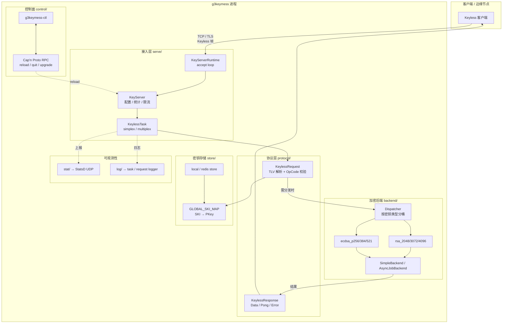
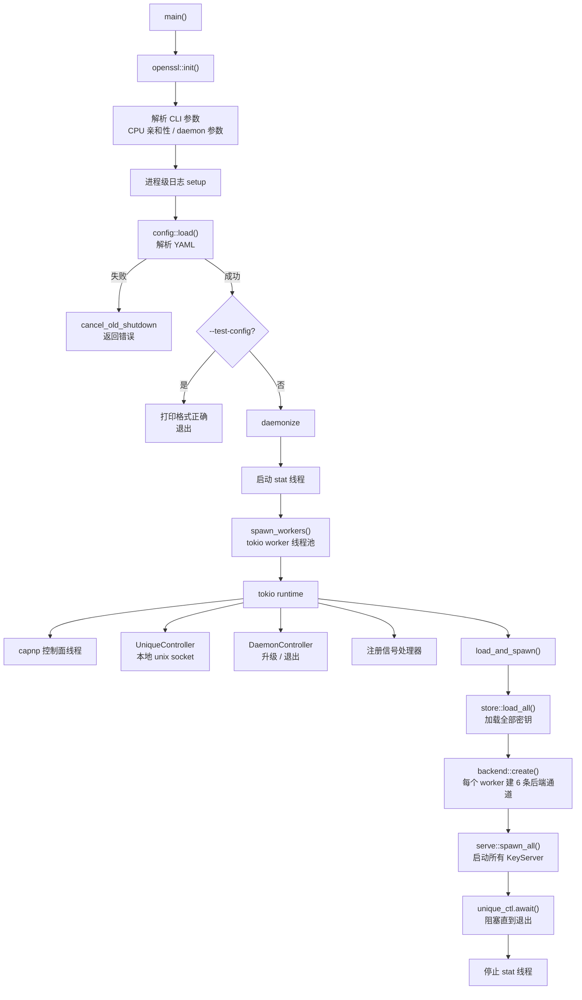
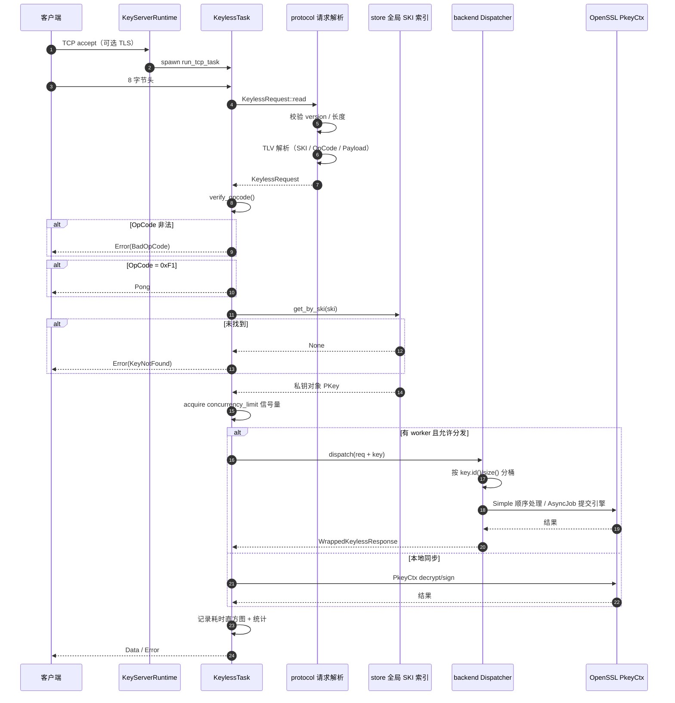
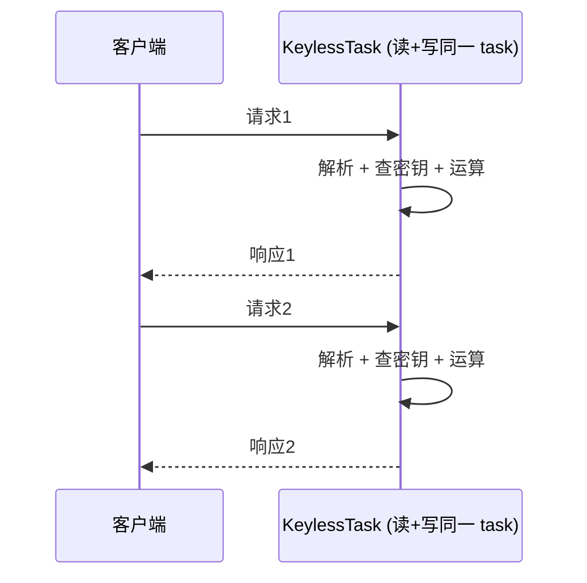
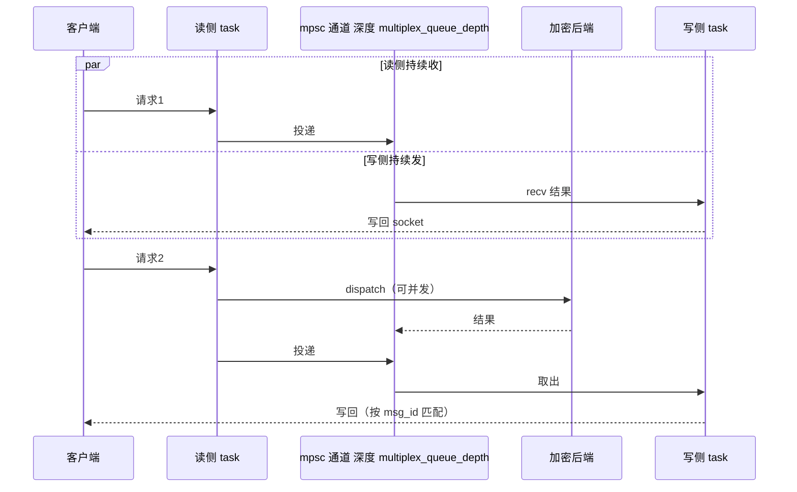
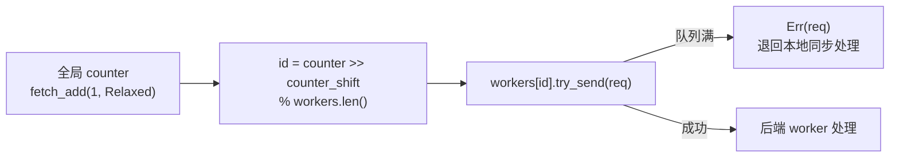
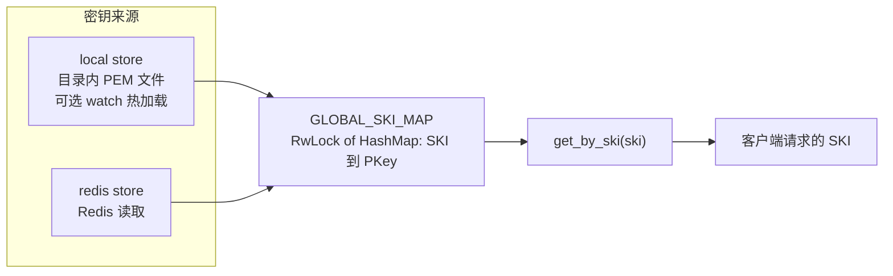
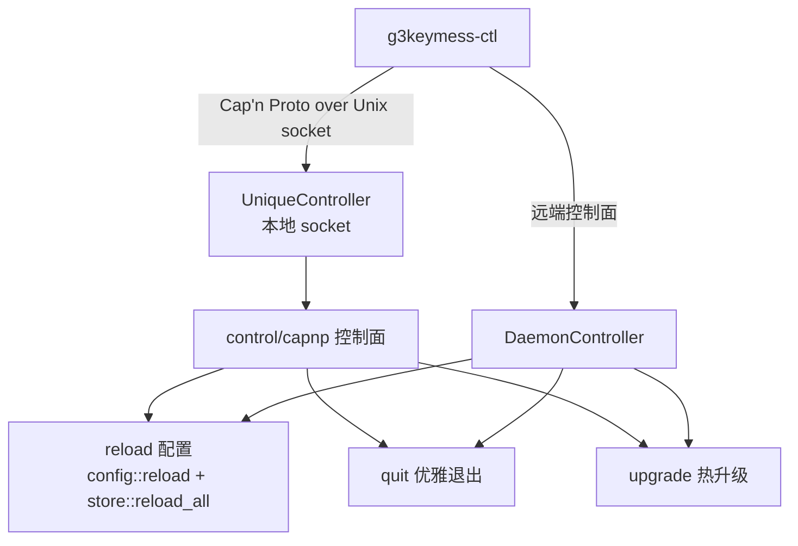
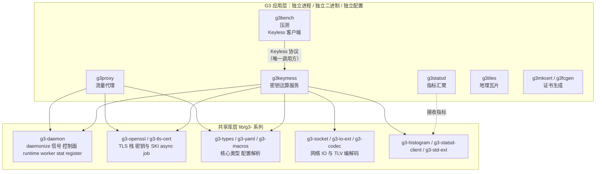
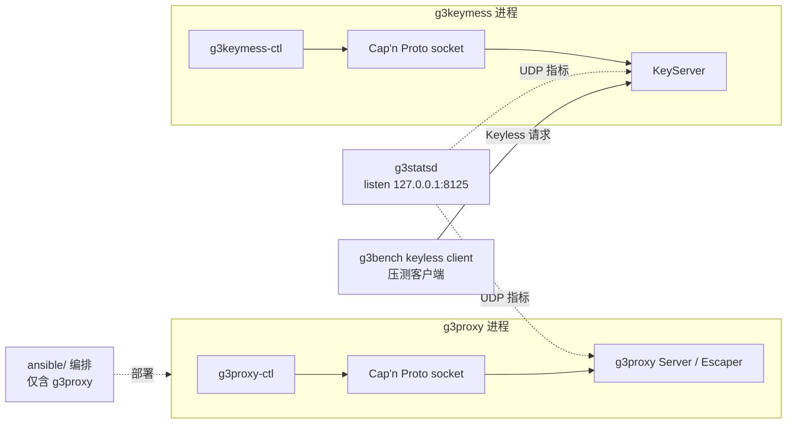

# g3keymess 源码架构分析

> 字节跳动开源 · Apache 2.0 · Rust Async · Cloudflare Keyless 协议服务端

---

## 目录

1. [项目定位](#1-项目定位)
2. [整体架构](#2-整体架构)
3. [启动流程](#3-启动流程)
4. [Keyless 协议实现](#4-keyless-协议实现)
5. [请求处理全链路](#5-请求处理全链路)
6. [任务模式：simplex 与 multiplex](#6-任务模式simplex-与-multiplex)
7. [加密后端与调度](#7-加密后端与调度)
8. [密钥存储](#8-密钥存储)
9. [控制面与可观测性](#9-控制面与可观测性)
10. [配置系统](#10-配置系统)
11. [关键设计决策](#11-关键设计决策)
12. [与 G3 项目群其他组件的关系](#12-与-g3-项目群其他组件的关系)
13. [速查表](#13-速查表)

---

## 1. 项目定位

g3keymess 是 **Cloudflare Keyless 协议** 的服务端实现。

### 一句话概括

> 把私钥留在服务端，客户端只发送待签名 / 待解密的摘要，服务端用私钥完成运算后回传结果。

典型场景：CDN 边缘节点把 RSA / ECDSA 私钥操作卸载到这台机器，边缘节点本身不持有私钥，从而缩小私钥暴露面。

### 能力矩阵

| 能力 | 说明 |
|------|------|
| **协议** | Cloudflare Keyless v1.0，二进制 TLV over TCP |
| **密码操作** | RSA 解密（PKCS1 / none）、RSA 签名（MD5_SHA1/SHA1/SHA224/256/384/512）、RSA-PSS 签名（SHA256/384/512）、ECDSA 签名（P-256/P-384/P-521 + 同组摘要）、Ed25519 签名、Ping/Pong |
| **密钥来源** | 本地目录（可 watch 热加载）、Redis |
| **TLS** | 可选 OpenSSL 服务端 TLS，支持 session resumption（quick ACK） |
| **执行引擎** | Simple（同线程顺序）、AsyncJob（OpenSSL async job，硬件引擎如 Intel QAT） |
| **并发控制** | 每服务 `concurrency_limit` 信号量；单连接多路复用队列深度可配 |
| **运维能力** | Cap'n Proto RPC 控制面、配置热加载、优雅退出、热升级、集群注册 |
| **可观测性** | StatsD 打点（按操作类型分桶 + 耗时直方图）、task 级日志、request 级日志 |

---

## 2. 整体架构



分层要点：

- **接入层** `src/serve/`：一个 `KeyServer` 对应一个监听地址与一套配置；`KeyServerRuntime` 跑 accept loop。
- **协议层** `src/protocol/`：纯编解码 + OpCode 语义，不含 IO。
- **后端层** `src/backend/`：真正做私钥运算的地方，可选同步或 OpenSSL async job。
- **存储层** `src/store/`：按 SKI 索引私钥。
- **控制层** `src/control/`：Cap'n Proto RPC + 本地 Unix socket。

---

## 3. 启动流程

入口 `src/main.rs`。



要点：

- 配置在 daemonize **之前**加载 —— 配置错误不会产生僵尸守护进程。
- `runtime.thread_number` 默认 0（用当前线程），`worker.thread_number` 决定加密后端的 worker 数。
- 存在 `pre_register` 配置时，先 `create_all_stopped()`，等注册中心确认后再 `start_all_stopped()`；注册失败则强制退出。

---

## 4. Keyless 协议实现

`src/protocol/request.rs` + `src/protocol/response.rs`。

### 4.1 帧格式

请求 = 8 字节头 + TLV 消息体：

```
 0                   1                   2                   3
 0 1 2 3 4 5 6 7 8 9 0 1 2 3 4 5 6 7 8 9 0 1 2 3 4 5 6 7 8 9 0 1
+-+-+-+-+-+-+-+-+-+-+-+-+-+-+-+-+-+-+-+-+-+-+-+-+-+-+-+-+-+-+-+-+
|    version    |     msg_len    |            msg_id             |
+-+-+-+-+-+-+-+-+-+-+-+-+-+-+-+-+-+-+-+-+-+-+-+-+-+-+-+-+-+-+-+-+
|  TLV 项 1 ...                        |  TLV 项 2 ...            |
```

- `version`：固定 `0x01 0x00`，否则返回 `UnexpectedVersion`
- `msg_len`：u16 BE，TLV 体长度
- `msg_id`：u32 BE，请求/响应配对

TLV 项（`T1L2BVParse`，长度 2 字节 BE）：

| tag | 含义 | 处理 |
|-----|------|------|
| `0x01` | cert digest | 忽略 |
| `0x04` | SKI | 密钥标识，查私钥用 |
| `0x11` | OpCode | 操作类型，1 字节 |
| `0x12` | Payload | 待签名摘要 / 待解密密文 |
| `0x20` | padding | 忽略 |
| 其他 | — | 忽略 |

### 4.2 OpCode 表

`verify_opcode()`（`request.rs:166`）：

| OpCode | 动作 | 备注 |
|--------|------|------|
| `0x01` | `RsaDecrypt(PKCS1)` | payload 长度须等于密钥字节数 |
| `0x02` | `RsaSign(MD5_SHA1)` | payload 长度须等于摘要长度 |
| `0x03`–`0x07` | `RsaSign(SHA1/SHA224/256/384/512)` | 同上 |
| `0x08` | `RsaDecrypt(NONE)` | payload 长度须等于密钥字节数 |
| `0x12` | `EcdsaSign(MD5_SHA1)` | payload 长度须等于摘要长度 |
| `0x13`–`0x17` | `EcdsaSign(SHA1/…/SHA512)` | 同上 |
| `0x18` | `Ed25519Sign` | payload 即消息 |
| `0x35`–`0x37` | `RsaPssSign(SHA256/384/512)` | PSS saltlen = DIGEST_LENGTH |
| `0xF1` | `Ping` | 回 Pong |
| 其他 | — | 返回 `BadOpCode` |

### 4.3 响应格式

| 响应 OpCode | 含义 |
|-------------|------|
| `0xF0` | 数据（解密明文 / 签名值） |
| `0xF1` | 错误，带 1 字节错误码 |
| `0xF2` | Pong |

错误码（`KeylessResponseErrorCode`）：

| 码 | 含义 | 码 | 含义 |
|----|------|----|------|
| 0 | NoError | 6 | UnexpectedOpCode |
| 1 | CryptographyFailure | 7 | FormatError |
| 2 | KeyNotFound | 8 | InternalError |
| 3 | ReadError | 9 | CertNotFound |
| 4 | VersionMismatch | 10 | Expired |
| 5 | BadOpCode | 11 | RemoteConfiguration |

---

## 5. 请求处理全链路



核心签名逻辑在 `KeylessRequest::process()`（`request.rs:280`），全部走 OpenSSL `PkeyCtx`：

- `RsaDecrypt` → `decrypt_init` + `set_rsa_padding` + `decrypt`
- `RsaSign` → `sign_init` + `set_signature_md` + `set_rsa_padding(PKCS1)` + `sign`
- `RsaPssSign` → 同上 + `set_rsa_padding(PKCS1_PSS)` + `set_rsa_pss_saltlen(DIGEST_LENGTH)`
- `EcdsaSign` / `Ed25519Sign` → `sign_init` + `sign`

所有 OpenSSL 失败统一映射为 `crypto_fail()`，不向外泄露具体错误。

---

## 6. 任务模式：simplex 与 multiplex

由 `server.multiplex_queue_depth` 决定（`server.rs:255`）。

### 6.1 simplex（depth <= 1）



一连接一请求一响应，串行处理。适合低并发、追求最低延迟的场景。

### 6.2 multiplex（depth > 1）



要点：

- 读侧只负责解析与投递，写侧独立 task 负责 `write_all` + `flush`。
- 请求处理可并发（分发到后端 worker），完成顺序与请求顺序不一定一致，靠 `msg_id` 配对。
- 写侧用 `try_recv` 排空队列后一次性 flush，减少 syscall。
- 需要 `worker.thread_number > 0` 才有实际并发（`server.rs:243` 的 `set_allow_dispatch`）。

---

## 7. 加密后端与调度

`src/backend/`。

### 7.1 分桶

`dispatch.rs` 按密钥类型分 6 个独立通道：

| 桶 | 判定 |
|----|------|
| `rsa_2048` | `key.id() == RSA` 且 `key.size() == 256` |
| `rsa_3072` | `key.id() == RSA` 且 `key.size() == 384` |
| `rsa_4096` | `key.id() == RSA` 且 `key.size() == 512` |
| `ecdsa_p256` | `key.id() == EC` 且 curve = `X9_62_PRIME256V1` |
| `ecdsa_p384` | curve = `SECP384R1` |
| `ecdsa_p521` | curve = `SECP521R1` |

不同密钥类型分配到不同 worker，避免 RSA 4096 的长耗时运算阻塞 P-256 签名。

### 7.2 选 worker



- `counter_shift`（默认 3）让连续多个请求落在同一 worker，形成局部性，减少跨核抖动。
- 用 `try_send` 而非 `send`：队列满时立即退回本地同步处理，避免请求无限堆积。

### 7.3 两种驱动

| 驱动 | 实现 | 适用 |
|------|------|------|
| `Simple` | `SimpleBackend` 单 worker 顺序 `recv` → 运算 → 回包 | 通用软件加密 |
| `AsyncJob` | `TokioAsyncOperation::build_async_task` 提交 OpenSSL async job，超时 `async_op_timeout`（默认 1s） | 硬件加密引擎（Intel QAT 等） |

AsyncJob 超时或失败都记为 `crypto_fail` 并回错误响应。

---

## 8. 密钥存储

`src/store/`。

### 8.1 全局索引



- 键是 **SKI**（Subject Key Identifier），客户端在 TLV `0x04` 里带过来。
- `get_by_ski` 返回 `PKey<Private>` 的克隆（`PKey` 内部引用计数），无锁读用 `RwLock::read`。
- `store::load_all()` 在启动时加载；`store::reload_all()` 在配置重载时重新加载，并清理已删除的 store。

### 8.2 local store

配置项：`name`、`type: local`、`dir`、`watch`。`watch: true` 时监听目录变化自动重新加载。

### 8.3 redis store

配置项：`name`、`type: redis`、`url`。`g3keymess-ctl` 提供 redis key store 的管理命令（上游 commit `5a487bb6` 把未实现分支改为返回错误而非 panic）。

---

## 9. 控制面与可观测性

### 9.1 控制面



- 控制通道是 Unix domain socket，路径通过 `ctl_local` 暴露。
- `pre_register` 配置存在时，进程把 `ctl_local` 路径 + pid 注册到注册中心，与集群其他组件发现。

### 9.2 指标

StatsD UDP 上报，prefix 来自配置（示例为 `g3keymess`），`emit_interval` 控制发送周期。

按操作类型分别统计：`ping_pong`、`rsa_decrypt`、`rsa_sign`、`rsa_pss_sign`、`ecdsa_sign`、`ed25519_sign`、`noop`。每类有 total / passed / alive / fail 计数，另有耗时直方图（`duration_stats`）。

### 9.3 日志

- **task 级**（`log/task.rs`）：连接生命周期，结束/错误时输出，带 `task_id`、`start_at`、`server_addr`、`client_addr`
- **request 级**（`log/request.rs`）：每个请求的结果与耗时
- `shared_logger` 可让多个 server 共用一个 logger 实例

---

## 10. 配置系统

顶层 YAML 结构（`config/mod.rs`）：

```yaml
runtime:      # tokio 线程数
worker:       # 加密后端 worker 数
log:          # 日志配置
stat:         # StatsD 上报
controller:   # 控制面
pre_register: # 集群注册
server:       # KeyServer 列表
store:        # 密钥存储列表
backend:      # 后端驱动（simple / async_job）
```

### server 可选键

| 键 | 默认 | 说明 |
|----|------|------|
| `name` | 必填 | 服务名，指标维度 |
| `listen` | 必填 | 监听地址 |
| `tls` / `tls_server` | 无 | OpenSSL 服务端 TLS 配置 |
| `multiplex_queue_depth` | 0 | >1 启用多路复用 |
| `request_read_timeout` | 100ms | 单请求读取超时 |
| `concurrency_limit` | 0（不限） | 并发信号量上限 |
| `duration_stats` | 默认 | 耗时直方图配置 |
| `async_op_timeout` | 1s | async job 超时（feature `openssl-async-job`） |
| `shared_logger` | 无 | 共享 logger 名 |
| `extra_metrics_tags` | 无 | 静态指标标签 |

### 最小示例

```yaml
log: journal
stat:
  target:
    udp: 127.0.0.1:8125
  prefix: g3keymess
  emit_interval: 200ms
server:
  - name: default
    listen: "[::]:1300"
    extra_metrics_tags:
      cluster: default
store:
  - name: local
    type: local
    dir: keys
```

启用多路复用 + worker（`examples/worker_openssl/g3keymess.yaml`）：

```yaml
worker:
  thread_number: 2
runtime:
  thread_number: 2
server:
  - name: default
    listen: "[::]:1300"
    multiplex_queue_depth: 128   # 必须 > 1 才能用 worker
```

---

## 11. 关键设计决策

| 决策 | 理由 |
|------|------|
| **按 SKI 而非证书指纹索引私钥** | Keyless 协议客户端直接带 SKI，避免每次解析证书 |
| **按密钥类型分 6 个后端桶** | 隔离长耗时运算（RSA-4096）与短耗时运算（P-256），防止队头阻塞 |
| **`counter_shift` 轮询而非哈希** | 保留请求局部性，减少跨核 cache 抖动 |
| **`try_send` 满则退回本地处理** | 有界队列 + 无界延迟，拒绝让请求无限堆积 |
| **simplex / multiplex 双模式** | 兼顾低延迟单请求与高吞吐管道场景；multiplex 是 Cloudflare 客户端的典型用法 |
| **multiplex 读写分离** | 慢请求不阻塞继续读新请求，吞吐不受单个慢操作拖累 |
| **OpenSSL 而非 RustCrypto** | 需要对接硬件加密引擎（async job）与国密栈（Tongsuo） |
| **错误码不外泄 OpenSSL 细节** | 统一 `crypto_fail`，避免向客户端泄露内部状态 |
| **配置在 daemonize 前加载** | 配置错误直接退出，不留半启动的守护进程 |
| **`pre_register` 时先建后启** | 未注册到集群就不对外监听，避免流量打到未就绪实例 |

---

## 12. 与 G3 项目群其他组件的关系

### 12.1 定位：平级独立应用，不是 g3proxy 的模块

g3keymess 与 g3proxy 是 G3（g3-project）workspace 下的**两个平级应用**：

- 各自是独立 crate、独立二进制、独立配置文件、独立进程
- **两者之间没有运行时调用关系** —— g3proxy 从不 spawn 或连接 g3keymess，g3keymess 也不感知 g3proxy
- 两者之间**没有代码依赖**：`g3keymess/Cargo.toml` 不依赖 g3proxy，`g3proxy/Cargo.toml` 也不依赖 g3keymess
- 但仓库内**确实存在 Keyless 客户端**：`g3bench` 的 `keyless` target（`g3bench/src/target/keyless/cloudflare/`）实现了 Cloudflare Keyless 协议客户端，会主动连接 g3keymess 做压测



### 12.2 真正的耦合点：共享 `lib/` 基础库

两者复用同一套基础设施，这才是"同一项目群"的实质：

| 共享库 | g3keymess 的用法 | g3proxy 的用法 |
|--------|------------------|----------------|
| `g3-daemon` | daemonize、信号、控制面、runtime/worker、stat、register | 同上 |
| `g3-openssl` | TLS acceptor、OpenSSL async job 抽象 | TLS 栈、MITM 握手 |
| `g3-tls-cert` | `key.ski()` 取 SKI、证书扩展 | 不直接依赖；证书相关经 `g3-tls-ticket` / `g3-cert-agent` 间接使用 |
| `g3-types` | `NodeName`、`MetricTagMap`、`TcpListenConfig`、`OpensslServerConfig` | 同类配置与指标类型 |
| `g3-yaml` | `HybridParser` 解析 YAML，`as_usize` / `as_duration` 等值转换 | 同 |
| `g3-codec` | `tlv` 模块解析 Keyless 帧 | `ldap` / `tls` 编解码 |
| `g3-socket` / `g3-io-ext` | `new_listen_to`、`LimitedTcpListener`、`LimitedBufReadExt` | 同 |
| `g3-histogram` / `g3-statsd-client` | 耗时直方图、StatsD 上报 | 各类流量指标 |
| `g3-ctl` / `g3-macros` / `g3-std-ext` | `g3keymess-ctl`、`AnyConfig` 派生 | `g3proxy-ctl` 等 |

结论：**换掉 g3proxy 不影响 g3keymess**，反之亦然；共享的只是底座。

### 12.3 统一的 "house style"

由于共享同一套 daemon 框架，g3keymess 与 g3proxy 在以下方面高度同构，运维经验可迁移：

| 维度 | 共同做法 |
|------|----------|
| 进程生命周期 | CLI 解析 → 日志 → 加载配置 → daemonize → runtime → 控制面 |
| 配置风格 | YAML；`server` / `store` / `backend` / `log` / `stat` / `controller` / `pre_register` 顶层键 |
| 控制面 | Cap'n Proto RPC over Unix socket + 同名 `-ctl` CLI（`g3proxy-ctl` / `g3keymess-ctl`） |
| 热加载 | `reload`（重读 YAML + 重载密钥）、`upgrade`（热升级）、`quit`（优雅退出） |
| 指标 | `g3-statsd-client` → StatsD UDP → g3statsd（示例 `127.0.0.1:8125`） |
| 指标维度 | `MetricTagMap` + `NodeName`，`extra_metrics_tags` 打标签 |
| 日志 | slog，`task` 级与 `request` 级双 logger，`shared_logger` 共享实例 |
| 特性开关 | TLS 后端 feature 对齐（`vendored-openssl` / `vendored-tongsuo` / `vendored-boringssl` / `vendored-aws-lc`） |

### 12.4 与 g3proxy 的差异对照

| 维度 | g3proxy | g3keymess |
|------|---------|------------|
| 角色 | 流量代理（入口协议 → 出口路由） | 密钥运算服务（请求 → 私钥运算 → 响应） |
| 协议 | HTTP/1.x、SOCKS4/5、SNI、TCP、FTP、QUIC、TLS … | 仅 Cloudflare Keyless 二进制 TLV |
| 状态 | 有状态：escaper 路由、用户组、ACL、审计会话 | 无状态：请求自带 SKI，服务端只按 SKI 取私钥 |
| 私钥 | TLS 服务端私钥与 MITM 所需证书私钥来自本地配置（`g3-yaml` 的 openssl server config） | 独立密钥库（local 目录 / redis），按 SKI 索引，请求自带 SKI |
| 复杂度来源 | 协议种类、路由策略、审计 | 密码运算调度、硬件引擎对接 |
| 依赖规模 | 33 个 `g3-*` 库 | 15 个 `g3-*` 库 |
| 单请求数据量 | KB ~ MB 级流 | 摘要级（20 ~ 64 字节 payload） |

### 12.5 互补场景与边界

概念上二者互补：**g3proxy 做流量转发，g3keymess 做私钥机**。但 g3proxy 与 g3keymess 之间**没有打通**，原因是：

- Keyless 是"发摘要 → 回签名/明文"的请求-响应模型，**不是 TLS 握手的组成部分**。Cloudflare 的用法是 CDN 边缘节点在握手过程中把私钥运算外包出去；g3proxy 是通用正向代理，不做这种外包，也无法把 g3keymess 当作 TLS 引擎挂进握手流程。
- g3proxy 侧的私钥操作（TLS 服务端握手、MITM 签发/生成叶子证书）都在握手流程内以本地私钥完成，不存在"把某次运算改成 RPC"的现成切点。
- 二者可以同机部署、TLS 特性开关对齐、指标汇入同一个 g3statsd，运维上天然兼容。

**仓库内的 Keyless 客户端是 g3bench**，而不是 g3proxy：

- `g3bench keyless cloudflare`（`g3bench/src/target/keyless/cloudflare/`）是完整的 Cloudflare Keyless 协议客户端实现
- 能力与服务端一一对应：TCP / TLS 两种连接方式、连接池（`pool.rs`）、simplex 与 multiplex 双模式（`connection/simplex.rs`、`connection/multiplex.rs`）、TLV 编解码（`message/request.rs`、`message/response.rs`）
- 另有 `g3bench keyless openssl` provider，用于对比"本地 OpenSSL 运算"与"远程 Keyless 运算"的性能差异
- 定位是 **g3keymess 的配套压测工具**，验证服务端吞吐与延迟

若将来要让 g3proxy 走 keyless 卸载私钥运算，g3bench 的客户端实现可直接参考或抽取复用（连接管理、TLV 编解码、SKI 携带逻辑），不必从零写协议栈。

### 12.6 部署与观测关系



- **控制面完全独立**：各自一个 Unix socket，互不感知。
- **指标汇聚**：两者都把指标打到 StatsD（`stat.target.udp`，示例 `127.0.0.1:8125`），由 g3statsd 统一导出。
- **部署编排**：仓库 `ansible/` 目前只编排 g3proxy（`g3proxy.yml` 等），**g3keymess 尚未纳入**，需自行部署。

---

## 13. 速查表

### 源码索引

| 路径 | 内容 |
|------|------|
| `src/main.rs` | 启动流程 |
| `src/opts.rs` | CLI 参数 |
| `src/signal.rs` | SIGUSR/SIGTERM 处理 |
| `src/config/` | YAML 配置类型（server / store / backend / log） |
| `src/protocol/request.rs` | 请求解析、OpCode 语义表、密码运算 |
| `src/protocol/response.rs` | 响应编码、错误码 |
| `src/serve/runtime.rs` | accept loop、离线切换 |
| `src/serve/server.rs` | KeyServer 生命周期、reload |
| `src/serve/task/simplex.rs` | 单连接单请求 |
| `src/serve/task/multiplex.rs` | 单连接多请求 |
| `src/serve/stats.rs` | 指标与耗时直方图 |
| `src/backend/dispatch.rs` | 分桶与 worker 选择 |
| `src/backend/simple.rs` | 同步后端 |
| `src/backend/async_job.rs` | OpenSSL async job 后端 |
| `src/store/` | SKI 索引与密钥加载 |
| `src/control/` | Cap'n Proto RPC 控制面 |
| `src/register.rs` | 集群注册 |
| `src/stat/` | StatsD 指标上报 |

### 常用命令

```bash
# 构建
cargo build -p g3keymess -p g3keymess-ctl
cargo build --profile release-lto -p g3keymess -p g3keymess-ctl

# 硬件引擎异步 job
cargo build --features openssl-async-job

# 运行
./target/release/g3keymess -c etc/g3keymess.yaml

# 控制
./target/release/g3keymess-ctl --help
```
