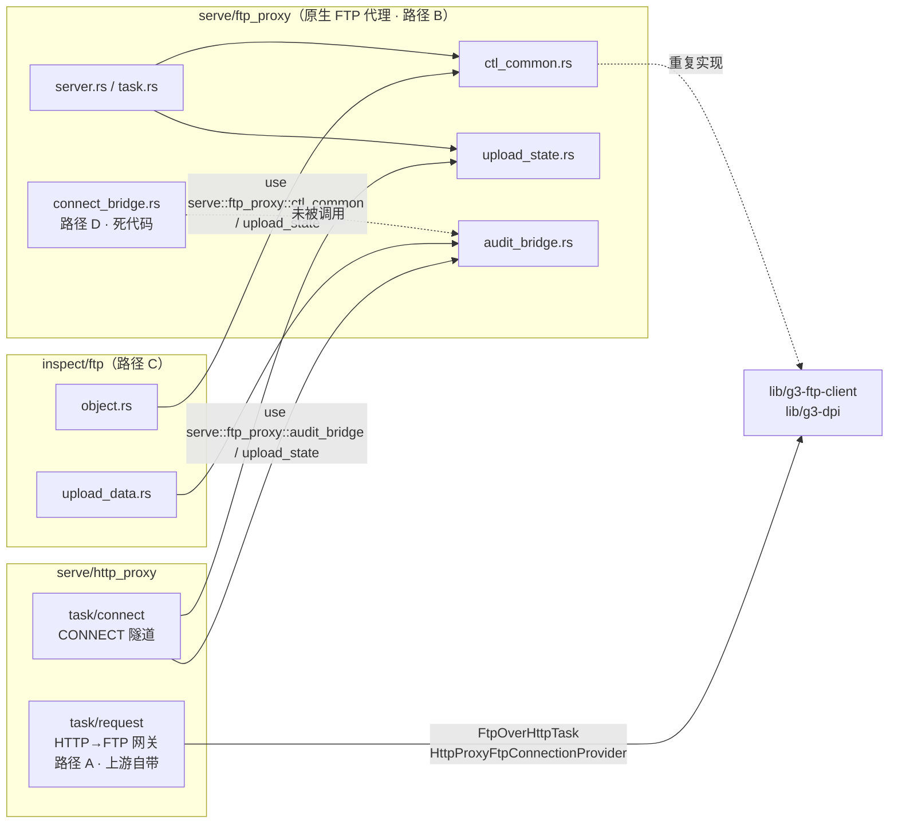
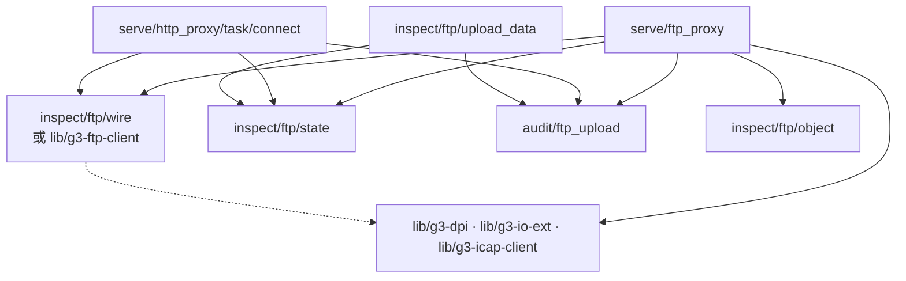

# g3proxy `serve/ftp_proxy` 模块架构评审与改进方向

> 一句话定位：评审 `g3proxy/src/serve/ftp_proxy/` 在 g3proxy 分层体系中的位置是否合规，
> 厘清它与 `http_proxy`、`inspect/ftp`、`lib/g3-ftp-client` 的关系，并给出 P0–P3 改进路线。
> 配套阅读：[g3项目架构理念与编码范式](g3项目架构理念与编码范式.md)（评判依据）、
> [g3proxy源码架构分析](g3proxy源码架构分析.md)、
> [inspect模块开发者新手入门](inspect模块开发者新手入门.md)、
> [etc-ftp配置业务流程分析](etc-ftp配置业务流程分析.md)。
> 所有路径为 workspace 相对路径，行号基于当前分支 `local/work-v113`。

---

## 目录

1. [结论摘要](#1-结论摘要)
2. [事实基线：仓库里有四条 FTP 路径](#2-事实基线仓库里有四条-ftp-路径)
3. [框架的分层契约是什么](#3-框架的分层契约是什么)
4. [ftp_proxy 做得对的地方](#4-ftp_proxy-做得对的地方)
5. [核心违规：依赖方向倒置](#5-核心违规依赖方向倒置)
6. [其它偏差清单](#6-其它偏差清单)
7. [与 http_proxy 的关系](#7-与-http_proxy-的关系)
8. [改进方向：P0–P3 路线](#8-改进方向p0p3-路线)
9. [目标形态](#9-目标形态)
10. [功能与协议缺口](#10-功能与协议缺口)
11. [证据索引](#11-证据索引)

---

## 1. 结论摘要

**位置本身没错，越界的是依赖方向。**

- `serve/ftp_proxy/` 作为一个"服务器类型"放在 `src/serve/` 下，与 `http_proxy`、`socks_proxy`、
  `sni_proxy` 并列，这是**正确**的。配置链（`config/server/mod.rs` → `serve/ops.rs`）、
  目录形态（`server.rs` / `task.rs` / `stats.rs`）也都对得上仓库范式。
- 问题在于：为了让另一条独立路径（`inspect/ftp`，即"协议检视拦截"）复用逻辑，
  `serve/ftp_proxy/` 里的三个子模块 `ctl_common` / `upload_state` / `audit_bridge`
  被**下层反向引用上层**——`inspect/` 和 `serve/http_proxy/` 一共 9 处 `use crate::serve::ftp_proxy::…`。
  按仓库分层，`inspect` 是"协议拦截状态机层"，`serve` 是"服务类型层"，
  依赖只能 `serve → inspect`，不能反过来。
- 为容纳这些反向引用，`serve/mod.rs:32` 把 `ftp_proxy` 开成了 `pub(crate)`——
  它是 `src/serve/` 下**唯一**一个非私有 server 模块。这是这个结构性问题的可见症状。
- 另一个信号：`ctl_common.rs::parse_pasv_response()`（含 EPSV 解析）与上游 crate
  `lib/g3-ftp-client/src/control/response.rs:80 parse_pasv_227_reply()`、
  `control/mod.rs:330 request_pasv_port()` 是**重复造轮子**；
  `connect_bridge.rs` 则是**零引用孤儿**，功能已被 `inspect/ftp/object.rs` 取代。

**一句话**：这不是"放错目录"，而是"该下沉到 `lib/` 的东西留在了 server 模块里，
并且被当成了全局基础设施"。

---

## 2. 事实基线：仓库里有四条 FTP 路径

评审前必须先摆清事实：FTP 相关代码在树里有 **4 条**互不相干的实现路径。

| # | 路径 | 来源 | 职责 | 是否活跃 |
|---|------|------|------|----------|
| A | `g3proxy/src/serve/http_proxy/task/ftp/` | **上游 v1.13.0 自带**（存在于 `b4d6c44f`） | 把 HTTP 请求（GET/PUT/DELETE）**翻译**成对上游 FTP 服务器的操作，即 HTTP→FTP 网关 | ✅ 上游正式功能 |
| B | `g3proxy/src/serve/ftp_proxy/` | **本地新增** | 原生 FTP 代理：改写 PASV/EPSV 应答把数据通道牵引到本机，上传走 ICAP REQMOD 审计 | ✅ 由 `ftp_proxy` server 类型驱动 |
| C | `g3proxy/src/inspect/ftp/` | **本地新增** | 协议检视层的 FTP 拦截：不重写 PASV，客户端直连 FTP 服务器，仅在数据通道上做审计 | ✅ 由 `inspect/stream` 状态机驱动 |
| D | `g3proxy/src/serve/ftp_proxy/connect_bridge.rs` | **本地新增** | HTTP CONNECT 隧道里承载 FTP 时的桥接 | ❌ **零引用**，被 C 取代 |

此外还有两个**上游基础设施**已被 B/C 重造或绕过：

| 基础设施 | 上游位置 | 本地重造点 |
|----------|----------|------------|
| PASV/EPSV 解析与请求 | `lib/g3-ftp-client/src/control/response.rs:80`、`control/mod.rs:330/351` | `serve/ftp_proxy/ctl_common.rs:parse_pasv_response()` / `parse_epsv_response()` |
| FTP 协议识别 | `lib/g3-dpi/src/protocol/ftp.rs`（`MaybeProtocol::Ftp`）、`Protocol::FtpControl` | `connect/task.rs:567` 用 `upstream_port == 21 \|\| == 990` 硬编码判断 |

> 这条基线很重要：任何"要不要重构 ftp_proxy"的讨论，都得先承认 A/B/C/D 是四套并行实现，
> 而不是一个模块的内部细节。

---

## 3. 框架的分层契约是什么

《g3项目架构理念与编码范式》§8 给了三问自检，本篇用到的是：

1. **放对层了吗**——协议逻辑进 `lib/g3-*`，守护机制进 `g3-daemon`，业务语义才留应用。
2. **配对形了吗**——新组件 = `config/<plane>/<type>.rs` + `<plane>/<type>/` + registry 注册
   + `diff_action()` + `depends_on` 声明 + sphinx 文档，五件套。
3. **守对线了吗**——热路径不引入 `Mutex<HashMap>` 查找（用 ArcSwap 或建连时解析一次）。

g3proxy 内部还有一层**未成文但被一致遵守**的依赖方向：

```
config/  ──解析──▶  registry  ──实例化──▶  serve/<x>_proxy/   （服务类型层：端口、hook、任务外壳）
                                              │
                                              ▼  serve → inspect（单向）
                                         inspect/<proto>/     （协议拦截状态机层）
                                              │
                                              ▼
                                        escape/ · audit/ · module/
                                              │
                                              ▼
                                        lib/g3-* （纯协议与工具）
```

**实证**：`grep -rn "crate::inspect" g3proxy/src/serve/` 有大量结果（serve 合法地调用 inspect），
而 `grep -rn "serve::ftp_proxy" g3proxy/src/inspect/` 有 6 处——
全仓 `inspect → serve::<具体代理>` 的引用**只存在于 ftp_proxy 这一个模块**。
其余所有 server 模块（`http_proxy`/`socks_proxy`/`sni_proxy`/`tcp_stream`）都是纯下依赖。

---

## 4. ftp_proxy 做得对的地方

评审不能只挑刺，以下几项完全符合仓库范式：

| 项 | 证据 |
|----|------|
| 配置注册链完整 | `config/server/mod.rs:25 mod ftp_proxy;`、`:135 FtpProxy(…)` 变体、`:207-210 "ftp_proxy" \| "ftpproxy"` 键名解析（含 `key::normalize` 等价写法）→ `serve/ops.rs:29 use` → `:313 AnyServerConfig::FtpProxy(c) => FtpProxyServer::prepare_initial(c)` |
| 解析/实例化分离 | `config/server/ftp_proxy.rs` 只做 YAML→`FtpProxyServerConfig`；运行时对象在 `serve/ftp_proxy/server.rs` 构造 |
| 重载语义 | `server.rs` 实现了 `prepare_initial` / `prepare_reload` / `drop_early` 与 `ServerInternal` 的 `_` 前缀钩子，与其它 proxy 形态对称 |
| 公开/内部 trait 分离 | 内部钩子以 `_` 前缀（`_clone_config` / `_reload` / `_update_config_in_place`），对外接口干净——正是范式文档§5 说的模式 |
| 指标命名 | `stats.rs` 走 `server.*` / `escaper.*` 风格，符合 `<plane>.<obj>.<unit\|stage>` 约定 |
| 文件头规范 | 8 个文件全部有 SPDX + copyright 头 |

---

## 5. 核心违规：依赖方向倒置

### 5.1 九处反向入边

```
g3proxy/src/inspect/ftp/object.rs:30    use crate::serve::ftp_proxy::ctl_common::{…}
g3proxy/src/inspect/ftp/object.rs:33    use crate::serve::ftp_proxy::upload_state::get_ftp_upload_state
g3proxy/src/inspect/ftp/object.rs:314   crate::serve::ftp_proxy::upload_state::get_ftp_upload_state().mark_ftps_domain(…)
g3proxy/src/inspect/ftp/upload_data.rs:23  use crate::serve::ftp_proxy::audit_bridge::{…}
g3proxy/src/inspect/ftp/upload_data.rs:26  use crate::serve::ftp_proxy::upload_state::{PendingUploadInfo, get_ftp_upload_state}
g3proxy/src/inspect/tls/modern.rs:130   crate::serve::ftp_proxy::upload_state::get_ftp_upload_state()…
g3proxy/src/inspect/start_tls/tls.rs:139 crate::serve::ftp_proxy::upload_state::get_ftp_upload_state().save_tls_session(…)
g3proxy/src/serve/http_proxy/task/connect/task.rs:30  use crate::serve::ftp_proxy::audit_bridge::{…}
g3proxy/src/serve/http_proxy/task/connect/task.rs:33  use crate::serve::ftp_proxy::upload_state::get_ftp_upload_state
```

**为什么这是问题而不是风格差异**：

- `inspect/ftp/object.rs:1-60` 的模块文档自己写着"与原生 FTP 代理不同：这里不重写 PASV 响应，
  客户端直接连通 FTP 服务器"。也就是说 C 路径与 B 路径**是两种不同的服务语义**，
  但 C 却把 B 的内部子模块当作公共基础设施使用。
- 后果一：**读代码的顺序被强制倒置**。要理解 `inspect/ftp`，必须先读 `serve/ftp_proxy`，
  而 `serve/ftp_proxy` 的文档从头到尾没提自己还承担"供 inspect 层复用"的职责。
- 后果二：**改 B 会崩 C**。`ctl_common` / `upload_state` 的任何签名调整，
  影响面横跨三个平面（`inspect/ftp`、`inspect/tls`、`inspect/start_tls`），
  但它们在语义上属于"FTP 协议公共工具"，本该有独立的模块边界和文档。
- 后果三：**可见性被迫放宽**。`serve/mod.rs:32 pub(crate) mod ftp_proxy;`——
  同组其它 server 模块全是私有 `mod`（见 §7 与 §11）。

### 5.2 根因

三个子模块（`ctl_common` 控制通道解析、`upload_state` 跨连接状态、`audit_bridge` ICAP 审计桥）
**都不是"原生 FTP 代理服务"专有的东西**——它们是"FTP 协议 + ICAP 审计"的公共能力。
按 §8 第一问"换个应用还用得上就下沉到 `lib/`"，它们的正确位置在下一层。

---

## 6. 其它偏差清单

| # | 偏差 | 证据 | 违背的信条 |
|---|------|------|------------|
| 1 | **全局单例 + 锁表出现在热路径**：`upload_state` 以 `static FTP_UPLOAD_STATE: OnceLock<Arc<FtpUploadState>>` 进程级共享，内含 `Mutex` 保护的 pending/domain/session 三张表，被 `inspect/*` 每条连接直接查写 | `upload_state.rs`（TTL 3600s、`max_pending_per_pair 16`、`max_domains/max_sessions 4096`） | §1 信条5"热路径无锁"；§8 第三问。范式文档明确写"只有低频的管理操作才用 `Mutex<HashMap>` 注册表" |
| 2 | **跨连接状态用 IP 对做键，NAT 下可能串标记**：pending 以 `(client_ip, server_ip)` 为键，多个客户端在同一出口 IP 后共享命名空间 | `upload_state.rs` 的 pending 索引结构 | 正确性；RFC 959 数据通道是 per-session 的 |
| 3 | **TTL/容量全部硬编码**，无 YAML 覆盖 | `upload_state.rs` 常量；`connect_bridge.rs` 中 `max_idle_count: 60`、`ftp_command: "STOR"`、`ftp_path: "ftp-over-connect"` 同样写死 | §1 信条3"配置驱动"；与其它 server 类型 `*_config()` 暴露方式不对称 |
| 4 | **`connect_bridge.rs` 是零引用孤儿**（312 行），路径 D 已被路径 C 取代 | `mod.rs` 中 `#[allow(dead_code)] pub(crate) mod connect_bridge;`，全仓无调用点 | 一致性；死代码留在树里会误导读者以为 CONNECT 走 FTP 有独立实现 |
| 5 | **两套 FTP 分发判定并存**：DPI 有 `MaybeProtocol::Ftp` / `Protocol::FtpControl`，`connect/task.rs` 又按端口号硬编码 | `lib/g3-dpi/src/protocol/inspect.rs:25,101,140` vs `connect/task.rs:567 let is_ftp_control = upstream_port == 21 \|\| upstream_port == 990;` | §7"以标准与统一实现为纲"；非 21/990 端口的 FTP 流量两条路径判定不一致 |
| 6 | **重复造轮子**：PASV/EPSV 解析在应用层重写了一份 | `ctl_common.rs:parse_pasv_response/parse_epsv_response` vs `lib/g3-ftp-client/src/control/response.rs:80`、`control/mod.rs:330/351` | §8 第一问"协议逻辑进 `lib/g3-*`" |
| 7 | **EPSV 上游地址取值时机 bug**：`into_running` 在 `connect_upstream()` 之前读 `tcp_notes.next`，此时字段尚未填充，`upstream_ip` 实际恒为 `0.0.0.0` | `task.rs::into_running`（注释已标注），`tcp_notes.next` 的 10 处赋值全在 `escape/*/tcp_connect/*.rs` 内部 | 正确性。EPSV 解析出的数据地址不可用 |
| 8 | **`stats.rs` 注释与实现不符**（`tcp_io_snapshot` 文档描述的口径与代码实际聚合方式有出入） | `serve/ftp_proxy/stats.rs` | §1 信条6"一致性"；文档可信度 |

---

## 7. 与 http_proxy 的关系

`ftp_proxy` 与 `http_proxy` **不是继承或包装关系，是并列的两个服务类型**，
共享 `serve` 框架外壳（`ListenTcpRuntime<S>`、`ServerInternal`、`AcceptTcpServer`）。
交集有三处，都在 `http_proxy` 一侧主动"伸手"：



| 关系维度 | 说明 |
|----------|------|
| 配置面 | 平级：`AnyServerConfig::{HttpProxy, FtpProxy}` 两个独立变体，各自的 `diff_action()` |
| 运行时 | 平级：都由 `serve/ops.rs` 实例化，各自持有 `ArcSwap<EscaperHandle>` / `AuditHandle` |
| 代码复用 | **不对称**：`http_proxy` 复用了 `ftp_proxy` 的子模块（`:30/:33`），反向没有 |
| 功能重叠 | A（HTTP→FTP 网关）与 B（原生 FTP 代理）解决的是两个不同问题：A 让浏览器/curl 用 HTTP 动词访问 FTP；B 让标准 ftp 客户端穿过代理 |
| `connect_bridge.rs` | 本意是给 CONNECT 隧道做 FTP 专用桥接，实际被 `http_proxy/task/connect/task.rs` 直接 `use` 子模块 + `inspect/ftp` 拦截这两条路取代 |

**结论**：`ftp_proxy` 之于 `http_proxy`，目前是"被借用工具库的邻居"，而不是"另一套完整代理"。
这也解释了为什么它必须 `pub(crate)`——但只要把它真正当作**工具层**看，
它就不该待在 `serve/` 里。

---

## 8. 改进方向：P0–P3 路线

按"收益 / 风险 / 改动量"排序。**P0+P1 一起做，才能真正解掉 §5 的依赖倒置。**

### P0 — 删除死代码（零风险，10 分钟）

- 删除 `g3proxy/src/serve/ftp_proxy/connect_bridge.rs`（312 行）与 `mod.rs` 里的
  `#[allow(dead_code)] pub(crate) mod connect_bridge;` 声明。
- 若担心路径 D 语义（CONNECT 隧道里的 FTP 上传审计）丢失：确认它已由
  `http_proxy/task/connect/task.rs` + `inspect/ftp/object.rs` 覆盖后再删；
  实测该文件无任何调用点，属于早期实现残留。
- 顺带清 `mod.rs` 中为它准备的 `#[allow(dead_code)]` 传播标记。

### P1 — 把三个公共子模块提升为中立层（核心修复，机械改动）

目标：`serve/ftp_proxy/` 只剩服务外壳，`inspect/` 与 `http_proxy/` 不再引用 `serve::ftp_proxy::*`。

| 子模块 | 建议去向 | 理由 |
|--------|----------|------|
| `ctl_common.rs`（743 行） | **`lib/g3-ftp-client`** 新增 `pub mod wire`（与既有 `control/response.rs:80` 合并），或退一步放 `g3proxy/src/inspect/ftp/wire.rs` | 纯协议编解码，正是"换个应用还用得上"的那类；且能顺手消掉 §6-6 的重复实现 |
| `upload_state.rs`（386 行） | `g3proxy/src/inspect/ftp/state.rs`（随 P2 改造成非全局） | 它是"控制通道与数据通道交接"的会话状态，语义属于协议拦截层 |
| `audit_bridge.rs`（448 行） | `g3proxy/src/audit/ftp_upload.rs`（贴近 `audit` 平面）或 `lib/g3-icap-client` 的 `reqmod::ftp` 旁 | 它是 ICAP 审计的适配层，与 `audit/` 平面同属一类基础设施 |

改动内容：`git mv` + 更新 §5.1 列出的 9 处 `use` + 把 `serve/mod.rs:32` 收回为私有 `mod ftp_proxy;`。
验证：`cargo check --all-targets` + `cargo clippy --tests -- --deny warnings`（仓库硬门槛）
+ `cargo test --lib serve::ftp_proxy`（现有 40 个单测应全部随 `ctl_common` 一起迁移）。

> 若不想引入 `lib/` 变更，**最小可接受方案**：三个子模块一律移到 `inspect/ftp/` 下，
> `audit_bridge` 移到 `audit/`。关键是消除 `inspect → serve` 这条边，位置选择是次要的。

### P2 — 去掉进程级全局状态（正确性 + 性能，需要设计）

1. **取消 `OnceLock` 单例**：把 `FtpUploadState` 改为 server 级 `Arc<FtpUploadState>`，
   经 `AuditHandle` / `StreamInspectContext<SC>` 按任务传递。
   这才是仓库其它模块对"需要跨连接交接的状态"的通行做法（对照 `ArcSwap` 注入点）。
2. **扩键**：至少改成 `(client_ip, server_ip, pasv_port)`，避免同 IP 多会话串标记（§6-2）。
3. **参数化**：TTL(3600s)、`max_pending_per_pair`(16)、`max_domains`/`max_sessions`(4096)、
   cleanup 周期(1000) 全部进 `FtpProxyServerConfig`，走 `g3-yaml` 的 `value/*` 解码器。
4. 若确定要保留全局表，退一步方案：`Mutex` → 分片或 `dashmap`，并在文档里
   明确记录"这是对 §1 信条5 的一处有意例外"，附容量与淘汰策略。

### P3 — 统一语义与修 bug（渐进）

- **修 §6-7 的 `upstream_ip` 时机**：在 `connect_upstream()` 返回之后再取 `tcp_notes.next`，
  或让 escaper 在建立控制连接时把 `SocketAddr` 显式返回。
- **用 `g3-dpi` 的协议识别替换 `upstream_port == 21/990` 硬编码**，
  让非标准端口 FTP 也走拦截；判定逻辑收敛到一处（`inspect/stream/object.rs:310` 已是正确位置）。
- **统一 B/C 两条路径的空闲与统计语义**：目前各自维护 `IdleWheel` tick 计数与
  `server_stats` 字节计数口径，建议共用 `StreamCopyConfig` + 一套 `*Recorder/*Stats/*Snapshot`。
- **修 `stats.rs::tcp_io_snapshot` 注释与实现的偏差**（§6-8）。

### 不建议做的事

- 不要为了"看起来干净"合并 A（`http_proxy/task/ftp`，HTTP→FTP 网关）与 B（原生 FTP 代理）——
  两者的客户端假设完全不同，A 是上游正式功能，合并风险远大于收益。
- 不要在 P1 之前先做 P2：全局状态的引用点分散在 5 个文件，先把位置定下来再改传递方式，
  否则两次的 import  churn 会叠在一起 review 不动。

---

## 9. 目标形态

P0+P1 完成后的目录与依赖：

```
g3proxy/src/serve/ftp_proxy/          # 纯服务外壳（路径 B）
  mod.rs          ← 私有：serve/mod.rs 改回 mod ftp_proxy;
  server.rs       ← FtpProxyServer + ServerInternal 钩子
  task.rs         ← FtpProxyTask：控制通道 relay、PASV 改写编排
  stats.rs        ← FtpProxyServerStats / Recorder

g3proxy/src/inspect/ftp/              # 协议层（路径 C + 公共工具）
  mod.rs
  wire.rs         ← 原 ctl_common（或由 lib/g3-ftp-client 提供）
  object.rs       ← FtpInterceptObject
  upload_data.rs  ← FtpUploadDataInterceptObject
  state.rs        ← FtpUploadState（P2 后 per-task 注入）

g3proxy/src/audit/ftp_upload.rs       # 原 audit_bridge（ICAP REQMOD 适配）
```

依赖图（全部同向，无回边）：



**验收标准**：`grep -rn "crate::serve::ftp_proxy" g3proxy/src/` 只应命中
`serve/mod.rs`、`serve/ops.rs`、以及 `serve/ftp_proxy/` 自身；
`pub(crate) mod ftp_proxy` 恢复为 `mod ftp_proxy`。

---

## 10. 功能与协议缺口

评审过程中发现的与 FTP 标准相关的实现缺口，供后续排期（RFC 引用取自 `doc/standards.md:300-325`）：

| # | 缺口 | 现状 | 相关规范 |
|---|------|------|----------|
| 1 | **主动模式（PORT / EPRT）完全未实现** | `ctl_common.rs` 中只有 `is_pasv_command`/`is_epsv_command`；全模块对 `PORT`/`EPRT` 的唯一提及是测试里的**反向断言**（`!is_pasv_command(b"PORT …")`）。若客户端坚持主动模式，代理无法牵引数据通道 | RFC 959 §20；应至少显式 `500` 拒绝或做透明处理 |
| 2 | **IPv6 / EPSV 语义未按 RFC 2428 处理** | `parse_epsv_response` 只接受 IPv4 控制对端（`ctrl_peer_ip: Ipv4Addr`），`rewrite_pasv_response` 对 IPv6 地址直接原样返回 | RFC 2428 §3.1.2/§3.2.2 |
| 3 | **EPSV 数据地址因 §6-7 时机 bug 恒为 `0.0.0.0`** | 实际不可用 | RFC 2428；RFC 1635（FTP 安全考量） |
| 4 | **PASV 改写写回 `Ipv4Addr::LOCALHOST`** | `task.rs` PASV 分支把代理地址替换成 `127.0.0.1`，只有本机客户端场景成立；跨机部署需替换为真实监听地址 | — |
| 5 | **TLS 会话复用（`require_ssl_reuse`）依赖全局表** | `inspect/tls/modern.rs:130` 查表恢复 session，`inspect/start_tls/tls.rs:139` 写表——一旦 P2 改成 per-task，此处需一并考虑 vsftpd 等服务端的复用要求 | RFC 4217 §10；`doc/ftp-icap-upload-fixes.md` |
| 6 | **多行应答完成判定偏保守** | `is_complete_response` 对首行非 `NNN` 的情况直接判定"已完成"，异常应答可能截断 | RFC 959 §4.2 |

---

## 11. 证据索引

| 命题 | 位置 |
|------|------|
| 分层契约与三问自检 | `doc/g3项目架构理念与编码范式.md` §1（信条5 热路径无锁）、§3、§8 |
| 唯一非私有 server 模块 | `g3proxy/src/serve/mod.rs:32 pub(crate) mod ftp_proxy;`（`:33-46` 同组其余为私有） |
| 配置注册链 | `g3proxy/src/config/server/mod.rs:25,135,207-210`；`g3proxy/src/serve/ops.rs:29,313` |
| 九处反向入边 | 见 §5.1 清单，全部经 `grep -rn "serve::ftp_proxy" g3proxy/src/` 核实 |
| inspect 路径不重写 PASV | `g3proxy/src/inspect/ftp/object.rs:1-60` 模块文档 |
| DPI 协议识别 | `lib/g3-dpi/src/protocol/inspect.rs:25,101,140`；`g3proxy/src/inspect/stream/object.rs:310 Protocol::FtpControl` |
| 端口硬编码分发 | `g3proxy/src/serve/http_proxy/task/connect/task.rs:519,523,567,568,593,619,665` |
| 上游 A 路径存在 | `g3proxy/src/serve/http_proxy/task/ftp/{task.rs,connection.rs,list.rs,stats/}`；`git ls-tree b4d6c44f:g3proxy/src/serve/http_proxy/task/` |
| 上游 FTP 客户端原语 | `lib/g3-ftp-client/src/control/response.rs:80`；`control/command.rs:54 (EPSV,"EPSV")`；`control/mod.rs:330,341,351` |
| `tcp_notes.next` 赋值全在 escaper | `g3proxy/src/escape/*/tcp_connect/*.rs` 共 10 处（direct_float:114,251；direct_fixed:130,265；proxy_socks5:82,219；proxy_float:76 等） |
| FTP RFC 索引 | `doc/standards.md:300-325` |
| 现有单测规模 | `ctl_common.rs` 测试模块（40 个用例，`cargo test --lib serve::ftp_proxy` 全绿） |

---

> 本文基于 `local/work-v113` 分支（upstream v1.13.0 + 本地 FTP 特性）实地核查。
> P0/P1 属纯机械移动 + import 调整，可在一次提交内完成并由 `cargo clippy --tests -- --deny warnings` 把关；
> P2 需要先定状态归属方案再动。
