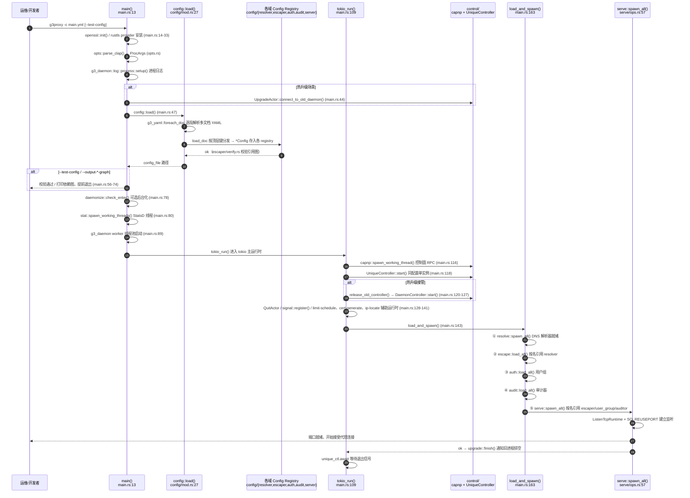

# g3proxy 代码贡献者新手入门

> 面向第一次接触 g3 项目源码的贡献者：如何搭好环境、跑起第一个代理、按什么顺序读代码、以及改完代码怎么提交。
>
> 配套阅读：深度架构请读 [g3proxy源码架构分析](g3proxy源码架构分析.md)；部署与配置语义请读
> [g3proxy/UserGuide.zh_CN.md](../g3proxy/UserGuide.zh_CN.md)；仓库级约定以根目录 `CLAUDE.md` 为准。

---

## 目录

1. [这个仓库里有什么](#1-这个仓库里有什么)
2. [搭好开发环境](#2-搭好开发环境)
3. [跑通第一个代理](#3-跑通第一个代理)
4. [源码导航：一套贯穿全局的模式](#4-源码导航一套贯穿全局的模式)
5. [阅读路线 A：进程是怎么启动的](#5-阅读路线-a进程是怎么启动的)
6. [阅读路线 B：一个 HTTP 请求走了哪些代码](#6-阅读路线-b一个-http-请求走了哪些代码)
7. [配置系统：对象之间是怎么认识的](#7-配置系统对象之间是怎么认识的)
8. [动手练习：加一种新的 escaper 要改哪些地方](#8-动手练习加一种新的-escaper-要改哪些地方)
9. [开发规范与提交流程](#9-开发规范与提交流程)
10. [新手常见卡点](#10-新手常见卡点)

---

## 1. 这个仓库里有什么

g3 是一个 Rust workspace（字节跳动开源，Apache 2.0），里面不止 g3proxy 一个程序：

| 目录 | 程序 | 一句话 |
|------|------|--------|
| `g3proxy/` | 正向代理 | **主产品**：HTTP/1+2、CONNECT、SOCKS4/5、FTP、SNI、透明代理、TLS 拦截 + ICAP 审计 |
| `g3tiles/` | 反向代理/负载均衡 | 配置风格与 g3proxy 一致，可对照学习 |
| `g3fcgen/` | 伪证书生成服务 | 为 g3proxy 的 TLS 中间人动态签发证书 |
| `g3keymess/` | Keyless 签名服务 | TLS 私钥不落代理机（见其专文分析） |
| `g3iploc/` | IP 归属地查询服务 | 供 `route_geoip` 出口使用 |
| `g3bench/` | 压测工具 | 代理协议基准测试 |
| `g3statsd/` | StatsD 服务端 | 指标收集 |
| `g3mkcert/` | 证书 CLI | 一键生成根/中间 CA、TLS/TLCP 证书 |
| `lib/` | 44 个共享 crate | g3proxy 的"积木"，协议编解码、socket、daemon 框架等 |

`lib/` 里**最值得优先读**的几个（读 g3proxy 代码前混个脸熟即可，不用细读）：

- `g3-types` — 全仓库的公共词汇表：`NodeName`、ACL 类型、认证结果、异步日志 trait
- `g3-yaml` — YAML 配置读取工具（`foreach_kv`、`yaml_str!`），所有配置解析都基于它
- `g3-daemon` — 守护进程框架：CLI 参数、监听（`ListenTcpRuntime`）、控制面、热升级协议
- `g3-http` / `g3-h2` — HTTP/1.x 编解码与 HTTP/2 集成
- `g3-socks` — SOCKS4/4a/5 协议编解码
- `g3-dpi` — 深度包检测（协议识别），供 audit 模块使用
- `g3-resolver` — DNS 解析驱动抽象（c-ares / hickory / DoQ）
- `g3-io-ext`、`g3-socket` — 限速拷贝/管道工具、跨平台 socket 选项

> 注意：仓库已进入维护模式，但结构稳定，非常适合用来学习大型 Async Rust 项目的组织方式。

## 2. 搭好开发环境

完整步骤见 [dev-setup.md](dev-setup.md)，这里给最小闭环：

```bash
# 1. 系统依赖（Debian/Ubuntu 为例；capnproto、openssl、c-ares、lua、python3 等）
#    详见 doc/dev-setup.md，不同发行版包名不同

# 2. 工具链：Rust ≥ 1.90，edition 2024
cargo --version

# 3. 全 workspace 检查（比编译快得多，日常用这个）
just check     # = cargo check --workspace
just test      # = cargo test --workspace --lib --examples
just clippy    # = cargo clippy --tests -- --deny warnings
just qa        # 三件套全跑，提交前必跑
```

编译 g3proxy 本体：

```bash
cargo build -p g3proxy -p g3proxy-ctl                    # debug
cargo build --profile release-lto -p g3proxy -p g3proxy-ctl  # release（发布用）
```

**feature 开关**是本项目编译的第一道坎：g3proxy 通过 Cargo features 选择 TLS 后端
（OpenSSL/BoringSSL/AWS-LC/Tongsuo 变体、rustls 的 ring/aws-lc 提供商）、是否启用
QUIC、Lua/Python 动态用户等。默认 feature 即可编译通过；改动前先看 `g3proxy/Cargo.toml`
的 `[features]` 段和 [openssl-variants.md](openssl-variants.md)。rustls 场景下
`main.rs:28` 有 `compile_error!` 兜底——必须启用一个 rustls provider，否则直接编译失败。

Cap'n Proto 绑定（控制面协议）已预生成并提交在 `*/proto/gen/`；改了
`g3proxy/proto/schema/*.capnp` 后才需要重新生成：

```bash
cargo run -p capnp-generate -- g3proxy/proto
```

## 3. 跑通第一个代理

不需要任何外部服务，5 分钟看到一个能转发的代理：

```bash
# 1. 写一份最小配置 /tmp/min.yml
cat > /tmp/min.yml <<'EOF'
runtime:
  worker_threads: 2

resolver:
  c_ares:
    name: default
    servers: [8.8.8.8]

escaper:
  direct_fixed:
    name: direct
    resolver: default

server:
  http_proxy:
    name: proxy
    listen:
      address: 127.0.0.1:8080
    escaper: direct
EOF

# 2. 先只验证配置格式，不启动服务
./target/debug/g3proxy -c /tmp/min.yml --test-config

# 3. 前台运行（不加 daemon 参数即前台）
./target/debug/g3proxy -c /tmp/min.yml

# 4. 另一个终端验证
curl -x http://127.0.0.1:8080 https://example.com -v
```

再学两个对读配置极有用的命令——它们把配置对象之间的引用关系画成图：

```bash
./target/debug/g3proxy -c /tmp/min.yml --output-mermaid-graph
# 输出: resolver "default" ← escaper "direct" ← server "proxy"
```

完整示例配置在 [g3proxy/examples/](../g3proxy/examples/)，每个目录对应一种场景
（HTTP 代理、SOCKS、TLS 拦截 + ICAP、多区域加速等），是照着抄的最佳来源。

## 4. 源码导航：一套贯穿全局的模式

`g3proxy/src/` 的目录布局：

```
src/
├── main.rs        # 进程入口（第 5 节逐段解读）
├── lib.rs         # 模块声明
├── opts.rs        # CLI 参数（clap）
├── signal.rs      # SIGHUP 重载 / SIGTERM 优雅退出 / SIGQUIT 强制退出
├── config/        # YAML → 强类型 *Config 结构（只解析，不启动）
├── serve/         # 入口层：15 种 Server（http_proxy、socks_proxy、sni_proxy…）
├── escape/        # 出口层：19 种 Escaper（direct_*、proxy_*、route_*）
├── resolve/       # DNS 解析层：c_ares、hickory、fail_over、deny_all
├── auth/          # 用户/用户组：认证、ACL、限流、动态用户源（file/lua/redis）
├── audit/         # 审计器：DPI 端口表、TLS 拦截上下文、ICAP 对接
├── inspect/       # 协议识别与拦截状态机（tls/http/websocket/imap/smtp/ftp）
├── module/        # 按协议的数据转发引擎（http_forward、tcp_connect、udp_relay…）
├── control/       # Cap'n Proto 控制面服务端、热升级、退出协调
├── log/           # 任务日志/逃逸日志/审计日志等异步日志管道
└── stat/          # StatsD 指标聚合线程
```

**几乎所有模块都长同一个样子**，记住这套模式后找代码不再费劲：

| 文件 | 职责 |
|------|------|
| `mod.rs` | 运行时对象 + 核心 trait（如 `Escaper`、`Server` trait 在 `escape/mod.rs`、`serve/mod.rs`） |
| `ops.rs` | `load_all()` / `reload()`：把 config 变成运行时对象（如 `serve/ops.rs`、`resolve/ops.rs`） |
| `registry.rs` | 全局注册表：`HashMap<NodeName, Arc<T>>`，按名字查找对象 |
| `task.rs` / `handle.rs` | 单条连接/单个请求的处理单元 |
| `<每种类型>/` 子目录 | 一种具体实现（如 `escape/direct_float/`、`serve/http_proxy/`） |

对应地，`config/` 下按同名目录只放**解析出来的配置结构体**（`config/server/http_proxy.rs`
里的 `HttpProxyServerConfig::parse(&Yaml, conf_dir)`），解析与实例化严格分离——
`--test-config` 能只解析不启动，就是因为这个分层。

## 5. 阅读路线 A：进程是怎么启动的

直接打开 [g3proxy/src/main.rs](../g3proxy/src/main.rs)（180 行，适合从头读到尾）：

1. **`main()`（`main.rs:13`）** — 按顺序做四件事：初始化 OpenSSL/rustls provider →
   `opts::parse_clap()` 解析命令行（`opts.rs`）→ 设置进程级日志 →
   若是热升级场景，先 `UpgradeActor::connect_to_old_daemon()` 连上旧进程（`main.rs:44`）。
2. **`config::load()`（`main.rs:47`，实现在 `config/mod.rs:27`）** —
   用 `g3_yaml::foreach_doc` 逐段读 YAML（支持多文档拼接），`load_doc` 把顶层键
   `resolver / escaper / user(_group) / auditor / server / runtime / log / stat / controller`
   分发给 `config/` 下对应子模块，**只解析成 `*Config` 结构存进各 registry**。
   随后 `--test-config` 或 `--output-*-graph` 就在这里提前退出。
3. **daemonize + worker 线程（`main.rs:78-90`）** — `g3_daemon::daemonize::check_enter`
   进后台；`spawn_workers()` 起 tokio worker 线程池；StatsD 线程 `stat::spawn_working_threads`。
4. **`tokio_run()`（`main.rs:109`）** — 进入 tokio 主运行时后依次：
   起 Cap'n Proto 控制线程（`control::capnp::spawn_working_thread`）→
   `UniqueController::start`（保证同 config 只有一个实例在跑）→
   `QuitActor` → `signal::register()` → 三个辅助运行时（限速调度 `g3_io_ext`、
   证书代生成 `g3_cert_agent`、IP 归属 `g3_ip_locate`）。
5. **`load_and_spawn()`（`main.rs:163`）** — 注意这个顺序，它就是依赖方向：

   ```
   resolve::spawn_all() → escape::load_all() → auth::load_all()
     → audit::load_all() → serve::spawn_all()
   ```

   resolver 先就绪，escaper 构造时按名字取 resolver，server 构造时按名字取
   escaper/user_group/auditor。每个 `ops.rs` 内部会 `match` 配置枚举
   （如 `AnyServerConfig`）调用具体类型的 `prepare_initial`，
   最终监听在 `g3_daemon::listen::ListenTcpRuntime` 上建立
   （用 `g3_socket::tcp::new_std_listener`，**SO_REUSEPORT**）。

热重载（SIGHUP → `signal.rs` → `config::reload()`，`config/mod.rs:45`）走的是
"clear_all → 重新解析 → 各模块 `reload()` 对比新旧配置做差分"的路子，每种配置类型
返回自己的 `DiffAction`（原地 reload / 停旧起新 / 不动），级联顺序同上。

### 启动流程时序图

> 在 GitHub / VS Code / Typora 等支持 Mermaid 的环境中可直接渲染；
> 预渲染版本见 [g3proxy启动时序图.svg](g3proxy启动时序图.svg)。
> 图中行号以当前代码为准；①—⑤ 对应 `load_and_spawn()` 的加载顺序，即组件依赖方向。



读图要点：

- **解析与实例化严格分离**：`config::load()` 只把 YAML 变成 `*Config` 存进 registry，
  真正构造运行时对象全部发生在 ①—⑤；所以 `--test-config` 能"只看配置不启动"。
- **加载顺序 = 依赖方向**：resolver → escaper → server，SIGHUP 重载级联同序。
- **热升级不传 fd**：新旧进程靠 SO_REUSEPORT 同端口共存，由 `UpgradeActor` /
  `DaemonController` 在控制面上协调交接与排空（详见第 6 节末尾）。

## 6. 阅读路线 B：一个 HTTP 请求走了哪些代码

以最常用的 **HTTP 正向代理 GET 转发** 为主线，按调用顺序读：

```
accept → 读请求行/头 → 认证 → ACL → 选出口 → DNS → 建连 → 双向中继
```

| 步骤 | 代码位置 | 看什么 |
|------|----------|--------|
| 1. 接受连接 | `serve/http_proxy/server.rs` `HttpProxyServer::run_tcp_task` | 每连接派生 pipeline reader/writer 任务 |
| 2. 解析请求 | `serve/http_proxy/task/protocol/` + `lib/g3-http` | HTTP/1 报文怎么进内存 |
| 3. 用户认证 | `task/pipeline/writer.rs` `do_auth` → `auth/group/mod.rs`、`auth/user.rs` `UserContext` | Basic 认证、登录结果挂到连接上下文 |
| 4. ACL/限流 | `UserContext` 的 `check_proxy_request` / `check_upstream`（类型在 `g3_types::acl`）；速率限制在 `g3_io_ext` | 用户维度准入与配额在哪一步生效 |
| 5. 选出口 | `escape/egress_path.rs`（egress path 协商）+ `BoxHttpForwardContext`（`module/http_forward/context/`，注意其 `check_in_final_escaper`） | `route_*` 出口如何层层包到最终叶子出口 |
| 6. DNS 解析 | `resolve/handle.rs` `IntegratedResolverHandle` + `g3_resolver` 的 HappyEyeballs | 解析与建连接力竞速 |
| 7. 建立上游连接 | `escape/mod.rs` `Escaper` trait 的 `new_http_forward_context`，直连实现在 `escape/direct_float/` | 出口抽象的"正主"接口 |
| 8. 中继字节 | `module/http_forward/connection/`（`HttpForwardRead`/`HttpForwardWrite`）→ `task/forward/task.rs` `run_forward` | 请求/响应怎么双向搬运、怎么打点 |

**CONNECT（HTTPS 隧道）** 走同一入口，分派到 `task/connect/task.rs`
`HttpProxyConnectTask`：`tcp_setup_connection` 在上游建连、回 200 后进入
`transit`——**这里是审计拦截的接入点**：若 server 绑定了 auditor，隧道不直接透传，
而是进 `inspect/stream/mod.rs` 的 `transit_with_inspection`，由
`inspect/mod.rs` 的 `StreamInspection` 状态机嗅探 ClientHello，交给
`inspect/tls/` 做 TLS MITM（证书由 `g3_cert_agent` 向 g3fcgen 索取），解密后再按
H1/H2/WebSocket/SMTP/IMAP 分别拦截。想理解"代理怎么偷看 HTTPS"，读这两处即可：
`src/inspect/` 与 `src/audit/`。

控制面（`g3proxy-ctl` 所在 `g3proxy/utils/ctl/`）通过 **daemon 控制 unix socket**
（`lib/g3-daemon/src/control/`）发 Cap'n Proto RPC，进程侧对应 `src/control/capnp/`。
热升级不传 fd：新进程以相同配置启动（SO_REUSEPORT 允许新旧同时监听），通过控制面
协调旧进程排空下线（`serve::ops.rs` 的 `wait_all_tasks`）后退出。

## 7. 配置系统：对象之间是怎么认识的

三个要点，理解了就掌握了本项目的配置模型：

1. **按名字引用**。`server.http_proxy` 里的 `escaper: direct`、`user_group: default`
   都是字符串名字（`NodeName`），启动/重载时经各模块 `registry.rs` 查找；
   `config/escaper/verify.rs` 在解析阶段校验引用图完整性（悬空引用直接报错）。
2. **同类型多实例**。每种组件都能配多个（如多个 resolver、多个 escaper），
   彼此用 `name` 区分；`route_*` 类 escaper 引用其它 escaper 的名字，形成出口树。
3. **图可导出**。`--output-mermaid-graph` / `--output-graphviz-graph` /
   `--output-plantuml-graph`（`config/mermaid.rs` 等）遍历所有 registry 打印依赖图——
   调试复杂配置时的第一推荐手段。

配置文件支持多文档 YAML（`---` 分隔可拼接），也支持按目录拆分
（`resolver/`、`escaper/`、`server/` 子目录各放一个文件）。字段级语义的权威参考
在 [sphinx/](../sphinx/)（即 readthedocs 上的手册源文件，注意它是**手写 rst**，
不是从结构体自动生成的）。

## 8. 动手练习：加一种新的 escaper 要改哪些地方

以新增一个假想的 `route_xxx` 出口为例，标准动线（server/resolver 同理）：

1. **配置结构**：`src/config/escaper/` 新增 `xxx.rs`，写 `XxxConfig::parse(&Yaml, conf_dir)`，
   并挂进 `escaper/mod.rs` 的 `AnyEscaperConfig` 枚举（`#[derive(AnyConfig)]` 派生宏，来自 `g3-macros`）。
2. **运行时对象**：`src/escape/route_xxx/` 新建子目录，`mod.rs` 里实现
   `Escaper` trait（`tcp_connect` / `udp_connect` / `new_http_forward_context` 等方法，
   见 `src/escape/mod.rs`）；若是路由型，构造时通过 `escape/registry.rs` 按名持有下游出口。
3. **接线**：`src/escape/ops.rs` 的 match 分支里加"配置 → 实例"的构造逻辑，
   并声明 `depends_on`（决定重载级联顺序）。
4. **注册与重载**：在 registry 完成注册，实现配置 diff 语义（变更时
   `Reload` 还是 `SpawnNew`）。
5. **文档**：在 `sphinx/g3proxy/configuration/escapers/` 新增 `<新类型名>.rst` 并登记到其 `index.rst`，
   PR 里同步更新 `g3proxy/CHANGELOG`。
6. **验证**：`just qa` 全绿；写一份引用新 escaper 的 YAML，
   `--test-config` 验解析、`--output-mermaid-graph` 验依赖图，再真实跑流量。

建议第一次练手前先完整读一遍最简实现 `escape/direct_float/` 和一个路由实现
`escape/route_failover/`，两者加起来就是本模块的"接口 + 用法"范本。

## 9. 开发规范与提交流程

- 规范文件：[根目录 CLAUDE.md](../CLAUDE.md)（构建/测试/feature 一览，最权威）、
  [CONTRIBUTING.md](../CONTRIBUTING.md)、[standards.md](standards.md)。
- 提交前：`just qa`（check + test + clippy，clippy 是 `--deny warnings`）。
- 单测跑法：`cargo test -p <package> <test_name>`。
- PR 标题格式 `area: message`（如 `g3proxy: fix socks udp associate timeout`），
  合入采用 squash-merge。
- 覆盖率相关见 [code_coverage.md](code_coverage.md)；打包/发版见
  [build_and_package.md](build_and_package.md)。

## 10. 新手常见卡点

| 卡点 | 解法 |
|------|------|
| 编译报错缺 OpenSSL/c-ares/lua 等系统库 | 按 [dev-setup.md](dev-setup.md) 装齐；或改 Cargo feature（如 `vendored-openssl`） |
| `either rustls-aws-lc or rustls-ring should be enabled` | rustls provider 必须选一个，见 `main.rs:20-33` |
| 找不到"配置项对应哪段代码" | 顶层键 → `config/<域>/` 找 `*Config::parse` → `<域>/ops.rs` 找构造点 |
| 不知道对象依赖关系怎么连起来 | 任何配置跑一下 `--output-mermaid-graph` |
| 改了 `.capnp` 不生效 | 需要 `cargo run -p capnp-generate -- g3proxy/proto` 重新生成，或清掉 `G3_CAPNP_USE_PRECOMPILED` |
| 想调试 TLS 拦截但证书生成失败 | 先单独起 `g3fcgen`（见 `g3fcgen/examples/`），再跑 `examples/inspect_http_proxy/` 场景 |
| 端口起不来 / 新旧进程互相干扰 | 本项目监听用 SO_REUSEPORT，同端口多实例是设计使然；用 `UniqueController` 报错信息定位冲突配置 |

---

> 文档基于本分支（upstream v1.13.0 + 本地特性）源码整理。行号以当前代码为准，
> 版本迭代后可能漂移，定位时优先搜函数/类型名。
