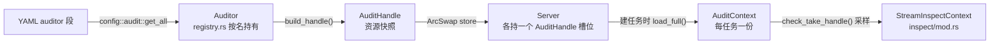
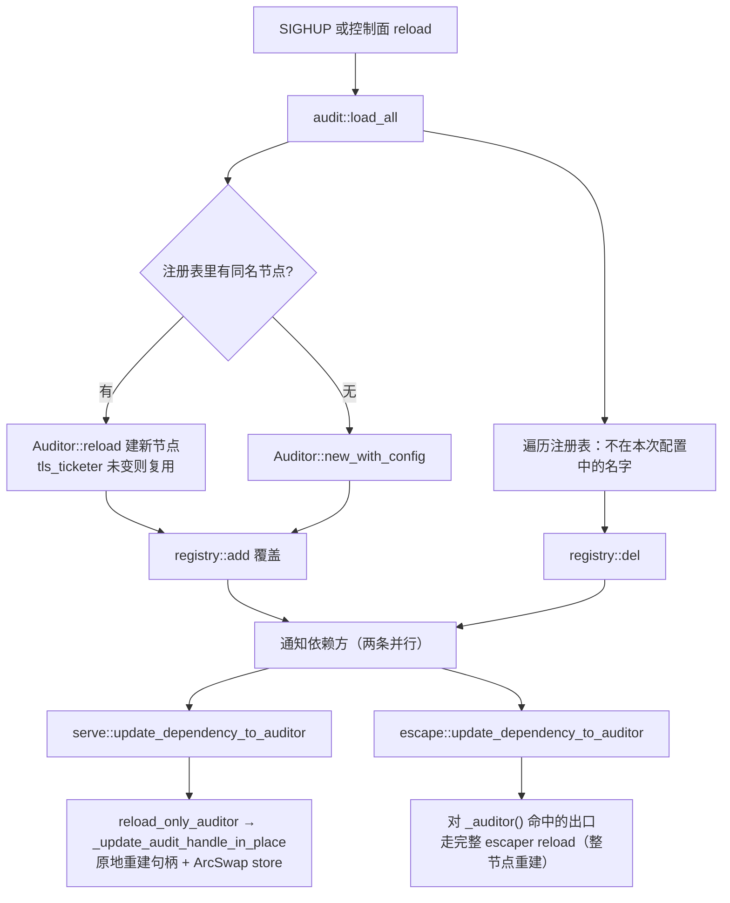

# g3proxy 审计（audit）模块开发者新手入门

> 面向第一次接触 g3proxy 审计链路的贡献者：audit 到底管哪几件事、怎么跑通一次 TLS 拦截、
> 代码从 `serve/` 是怎么走进 `audit/` 与 `inspect/` 的、auditor 的每个配置项控制什么、以及改完怎么验证。
>
> 配套阅读：全局视角请读 [g3proxy代码贡献者新手入门](g3proxy代码贡献者新手入门.md)（启动顺序、配置模型、提交流程）；
> **协议识别与拦截状态机**（`inspect/`）另有专文 [g3proxy inspect 模块开发者新手入门](inspect模块开发者新手入门.md)——
> 本文只讲 `audit/` 这侧：节点/句柄/注册表、auditor 每个配置项控制什么、热加载语义、QUIC 引流；两者不重复。
> 审计器字段的官方语义在 [sphinx/g3proxy/configuration/auditors/index.rst](../sphinx/g3proxy/configuration/auditors/index.rst)；
> 本模块的中文代码注释已随源码给出，本文只讲"为什么这样设计"和"怎么上手"。

---

## 目录

1. [audit 管的是哪几件事](#1-audit-管的是哪几件事)
2. [十分钟跑通一次 TLS 拦截](#2-十分钟跑通一次-tls-拦截)
3. [源码地图](#3-源码地图)
4. [三层对象：Auditor / AuditHandle / AuditContext](#4-三层对象auditor--audithandle--auditcontext)
5. [一条流量是怎么进审计的](#5-一条流量是怎么进审计的)
6. [auditor 配置项全表](#6-auditor-配置项全表)
7. [三条能力线的读码路线](#7-三条能力线的读码路线)
8. [热加载：换配置时谁跟着变](#8-热加载换配置时谁跟着变)
9. [日志与取证](#9-日志与取证)
10. [动手练习](#10-动手练习)
11. [新手常见卡点](#11-新手常见卡点)

---

## 1. audit 管的是哪几件事

一句话：**auditor 是一组"内容检查/拦截"能力的集合体**，代理服务器按名字引用它，
被引用到的任务才会从"透明转发"切换成"边转发边看内容"。它对外提供四种能力：

| 能力 | 配好后实际发生什么 | 关键实现位置 |
|------|--------------------|--------------|
| 协议识别（DPI） | 按端口表 + 报文嗅探判断这条流是什么协议，并决定拦截/旁路/阻断/引流 | `g3proxy/src/inspect/stream/`、`lib/g3-dpi/` |
| TLS 中间人（MITM） | 用 g3fcgen 现签的伪证书替服务端跟客户端握手，解密后再按 H1/H2/SMTP/IMAP/FTP 继续检查 | `g3proxy/src/inspect/tls/`、`lib/g3-cert-agent/` |
| ICAP 内容适配 | 把请求（REQMOD）/响应（RESPMOD）交给外部 ICAP 服务改写或送检 | `lib/g3-icap-client/`、`inspect/http/` |
| QUIC 引流检测 | 整条连接转给外部检测服务，由服务裁决继续/旁路/阻断 | `g3proxy/src/audit/detour/` |

注意第 4 项的实现**放在 audit 模块内部**（`src/audit/detour/`），而不是 `inspect/`：
因为它是"把连接交出去"，不涉及协议解析，本质上是一份审计资源而不是检查逻辑。

审计能力全部是**可选**的：一个 auditor 节点可以只配 `protocol_inspection: { }`
（只识别协议、不解 TLS），也可以什么都不配。但要分清两件事：

- **节点本身一定会实例化**——`audit::load_all()` 按配置遍历，跟有没有 server 引用无关。
- **后台任务只在配了对应能力时才 spawn**：`tls_ticketer` 会在节点创建时起密钥轮转任务
  （`audit/mod.rs:80-87`），`stream_detour_service` 会在节点创建时起 QUIC 连接池任务
  （`audit/mod.rs:148-153`），而伪证书签发任务是在**派生句柄时**才起
  （`build_handle()`，`audit/mod.rs:168-173`，每个引用该 auditor 的 server 一份）。
  只配 `protocol_inspection` 和端口表时，确实一个后台任务都不会有。

## 2. 十分钟跑通一次 TLS 拦截

TLS 拦截需要外部的伪证书签发服务 g3fcgen 在场，所以要起两个进程。
仓库里已有现成场景 [g3proxy/examples/inspect_http_proxy/](../g3proxy/examples/inspect_http_proxy/)。

```bash
cd /data/zf2zf/g3
cargo build -p g3proxy -p g3fcgen

# 1) 伪证书由一把自签 CA 现场签发。仓库里已经带了一把（CN=G3-test，CA:TRUE）：
#    g3fcgen/examples/simple/{G3-test.crt,G3-test.key}
#    想自己生成就用 g3mkcert：cargo run -p g3mkcert -- --help
# 2) 起 g3fcgen：配置里只填 backend.ca_certificate / ca_private_key，监听 udp 127.0.0.1:2999
./target/debug/g3fcgen -c g3fcgen/examples/simple/g3fcgen.yaml &

# 3) 起 g3proxy（场景里 auditor 多用空配置走默认值，log: stdout 会把检测结论直接打到终端）
./target/debug/g3proxy -c g3proxy/examples/inspect_http_proxy/g3proxy.yaml

# 4) 用代理访问 https，客户端必须信任第 1 步那把 CA，否则只会看到证书告警
curl -x http://127.0.0.1:10087 https://example.com -v \
     --cacert g3fcgen/examples/simple/G3-test.crt
```

场景里的 auditor 段（[g3proxy/examples/inspect_http_proxy/g3proxy.yaml:8-19](../g3proxy/examples/inspect_http_proxy/g3proxy.yaml)）：

```yaml
auditor:
  - name: default
    protocol_inspection: { }
    tls_cert_generator: { }          # 空配置 = 去 127.0.0.1:2999 取伪证书
    tls_interception_client: { }     # 代理 -> 真实服务端的 TLS 参数
    tls_ticketer: { }                # session ticket 密钥轮转
    h1_interception: { }             # HTTP/1 解析参数
    application_audit_ratio: 1.0     # 100% 采样
    # tls_stream_dump: { }           # 可选：解密流量 UDP 导出（默认 127.0.0.1:5555）
    icap_reqmod_service: icap://127.0.0.1:1344/echo
```

第一次跑建议**把 `icap_reqmod_service` 这行注释掉**：本机没有 ICAP 服务时，请求会在送检处报错，
而不是"跳过检查继续转发"。只想看协议识别 + TLS 拦截，这行是多余的依赖。

更接近生产的一份参考配置：[etc/g3proxy/http/auditor.d/default.yaml](../etc/g3proxy/http/auditor.d/default.yaml)
（额外开了 `tls_keylog` 与 `h1_interception.req_hasbody`）。
它是**目录式拆分**的写法：主配置里写 `auditor: auditor.d/`，目录下每个文件就是一段裸映射
（没有顶层 `auditor:` 键，也没有 `-` 列表符，见 [etc/g3proxy/http/g3proxy.yaml](../etc/g3proxy/http/g3proxy.yaml)）。

**只验证配置是否合法**（不启动、不需要 g3fcgen 在场）：

```bash
./target/debug/g3proxy -c g3proxy/examples/inspect_http_proxy/g3proxy.yaml --test-config
./target/debug/g3proxy -c <你的配置> --output-mermaid-graph   # 看 server -> auditor 的引用关系
```

> 顺序说明：`tls_cert_generator: { }` 只是建一个已 connect 的 UDP socket，
> g3proxy 不依赖 g3fcgen 先起来；但**首次需要伪证书时 g3fcgen 必须在跑**，
> 否则取不到证书，拦截会以 `NoFakeCertGenerated` 失败（`inspect/tls/modern.rs:199-207`）。

## 3. 源码地图

```
g3proxy/src/audit/
├── mod.rs            # Auditor 节点对象 + AuditContext（任务侧的取用入口）
├── ops.rs            # load_all() / reload()：注册表与配置的全量同步、单节点热加载
├── registry.rs       # 全局注册表 Mutex<HashMap<NodeName, Arc<Auditor>>>
├── handle.rs         # AuditHandle：任务真正伸手去拿的资源快照（所有访问器都在这）
└── detour/           # QUIC 引流（#[cfg(feature = "quic")]，关掉 quic 即整块消失）
    ├── mod.rs        # StreamDetourClient / StreamDetourContext / DetourAction
    ├── connect.rs    # 建 QUIC 连接、在连接上按请求开流、连接收尾
    ├── pool.rs       # 连接池后台任务：维持最小空闲连接、竞争消费取流请求
    └── stream.rs     # 单任务数据面：取裁决（PPv2 编解码）+ 三方流量中继

周边必读：
  config/audit/auditor.rs     # AuditorConfig：所有字段、默认值、YAML 键解析（本模块的"词典"）
  config/audit/detour.rs      # AuditStreamDetourConfig：引流服务的 9 个配置键
  escape/comply_audit/        # 唯一会替换任务 AuditContext 的出口（§5.3）
  inspect/mod.rs              # StreamInspectContext：审计句柄在检查层的展开
  inspect/stream/mod.rs       # 协议识别状态机主循环 into_loop_inspection
  log/audit.rs                # 以 auditor 为维度的 inspect / intercept 日志器
  lib/g3-dpi/                 # ProtocolPortMap、ProtocolInspectionConfig、各协议 interception 配置
  lib/g3-cert-agent/          # 伪证书签发客户端（缓存、批量合并、专用签发 runtime）
  lib/g3-tls-ticket/          # session ticket 密钥轮转器与后台更新任务
  lib/g3-icap-client/         # REQMOD/RESPMOD 客户端（H1/H2/SMTP/IMAP/FTP 适配器）
  lib/g3-udpdump/             # 解密流量导出（StreamDumper）
```

`audit/` 只有 8 个文件、约 1300 行，但它是整个仓库里**结构最标准**的模块之一：
`ops.rs + registry.rs + mod.rs + handle.rs` 四件套正是 g3proxy 每个可配置对象的固定形状，
读懂一个就读懂了全部（见[全局入门第 4 节](g3proxy代码贡献者新手入门.md)）。

## 4. 三层对象：Auditor / AuditHandle / AuditContext

这三层是审计模块最容易被新人搞混的地方。它们分别对应"**配置节点**""**资源快照**""**任务的一次性取用**"：

| 对象 | 定义 | 谁持有 | 数量 | 变化时机 |
|------|------|--------|------|----------|
| `Auditor` | `audit/mod.rs:42` | 全局注册表 `registry.rs:20` | 每个 auditor 名一份 | 配置重载时被**整体替换** |
| `AuditHandle` | `handle.rs:31` | 各 server 的 `ArcSwapOption<AuditHandle>`；`comply_audit` 出口直接持有一份 `Arc<AuditHandle>` | 每个引用它的节点一份 | auditor 变更时由 server 重建并 store |
| `AuditContext` | `audit/mod.rs:198` | 每个任务结构体 | 每任务一份（可 clone） | 任务创建时取一次，之后不变 |



关键设计点，理解这三条就够：

1. **句柄不是"实时配置"，而是装载那一刻的快照。** server 在 `config.get_audit_handle()`
   （`config/server/mod.rs:110`）里调 `Auditor::build_handle()`，把结果存进自己的
   `ArcSwapOption`；之后每条连接建任务时 `load_full()` 取当时的最新值。
2. **`check_take_handle()` 会 take 走句柄**（`audit/mod.rs:220`）——不管采样是否命中，句柄都被取空，
   因此同一任务只能审计一次，不会在多个阶段重复送检。
3. **热加载替换的是节点，不是运行中的任务。** 旧任务手里的 `Arc<AuditHandle>` 让旧资源继续存活，
   不会出现"任务执行到一半签发代理被换掉"的情况。

## 5. 一条流量是怎么进审计的

有两个不同粒度的入口，新人最容易在这里迷路：

### 5.1 连接级入口（4 处）：整条 TCP 流交给状态机

`check_take_handle()` 的全部调用点只有四处，逻辑高度一致：

| 调用点 | 拿到句柄后 | 没拿到时 |
|--------|------------|----------|
| `serve/tcp_stream/task.rs:280` | 构造 `StreamInspectContext`（:294）→ `transit_with_inspection`（:303） | `transit_transparent` 透明拷贝（:316） |
| `serve/tls_stream/task.rs:269` | 同上（:283 → :292） | :305 |
| `serve/tcp_tproxy/task.rs:244` | 同上（:258 → :267） | :280 |
| `serve/sni_proxy/task/relay/task.rs:279` | 构造上下文后**按已识别协议直接分派**拦截对象（:293-359） | :364 起纯 TCP 拷贝 |

前三处是"裸 TCP 流进去，让状态机自己嗅"，第四处（SNI 代理）已经知道协议，直接进对应拦截对象。
另外还有一条同形状的路径走的是"只借不消耗"的 `handle()`：SOCKS 的 tcp_connect
（`serve/socks_proxy/task/tcp_connect/task.rs:399` → :412 进状态机）。

**拿到句柄不等于进检测**，四处都是同一个两级门：

```rust
let audit_task = user_ctx
    .map(|ctx| {
        let u = &ctx.user_config().audit;
        u.enable_protocol_inspection && u.do_task_audit().unwrap_or_else(|| audit_handle.do_task_audit())
    })
    .unwrap_or_else(|| audit_handle.do_task_audit());
```

- 无认证用户时：只看 auditor 的采样率 `task_audit_ratio`（`AuditHandle::do_task_audit()`）。
- 有认证用户时：**必须**该用户的 `audit.enable_protocol_inspection: true`（默认 **false**，
  `config/auth/user/audit/mod.rs:22`，语义见 [sphinx auth/audit.rst](../sphinx/g3proxy/configuration/auth/audit.rst)），
  再叠加用户自己的 `task_audit_ratio`（没配则回落到 auditor 的）。
  用户维度还带 `prohibit_unknown_protocol` / `prohibit_timeout_protocol`（后者默认 true），
  命中时直接把"认不出/超时"的流拒掉，而不是放行。

### 5.2 请求级入口：HTTP 内部各阶段自己伸手取资源

HTTP/1、HTTP/2、FTP 的请求/响应处理阶段会直接读 `handle()`（不消耗句柄），
按需取 ICAP 客户端、TLS 上下文、日志器。例如：

```
serve/http_proxy/task/forward/task.rs:652 / 666 / 897 / 1666
serve/http_proxy/task/connect/task.rs:594 / 622 / 667
serve/ftp_proxy/task.rs:96 、 connect_bridge.rs:69
```

注意 `connect/task.rs:667` 这一处：HTTP CONNECT 隧道建好上游后，用的还是 §5.1 那套
"审计句柄 + 两级门 + `transit_with_inspection`"，所以 **http_proxy 也是检测入口**，
只是它先解析了外层 HTTP 请求行。

所以"连接级 = 决定要不要开始看内容；请求级 = 在看内容的具体环节里取参数"。

### 5.3 第三种入口：出口层可以整体换掉审计上下文

`Escaper` trait 有一个默认空实现的方法 `_update_audit_context()`（`escape/mod.rs:110`），
路由型出口在最终选定叶子出口时会被调用（调用点见 `module/http_forward/context/route.rs:61`、
`failover.rs:143`、`direct.rs:54` 等）。目前唯一的重写实现是 **`comply_audit` 出口**
（`escape/comply_audit/mod.rs:215`）：它构造时按自己配置的 `auditor:` 建一份句柄
（`:55-58`），请求经过它时把任务的 `AuditContext` **替换**成这一份。

用途：让"必须被审计"成为出口的前置条件——即使用户组/服务器没配 auditor，走这个出口的流量也会按
该 auditor 的参数检查。配置语义见
[sphinx escapers/comply_audit.rst](../sphinx/g3proxy/configuration/escapers/comply_audit.rst)。

### 5.4 状态机与防递归

进入检查后由 `StreamInspection`（`inspect/mod.rs:459`）驱动，主循环
`into_loop_inspection`（`inspect/stream/mod.rs:571`）——**细节全部在
[inspect 模块入门](inspect模块开发者新手入门.md) 的第 5、6 节**，这里只留两条与 auditor 配置直接相关的：

```
StreamInspect ──► TlsModern / TlsTlcp / StartTls ──► H1 / H2 ──► Websocket
   （裸流识别）      （解 TLS）                       （应用层协议）   （Upgrade / extended CONNECT 派生）
        └──────────── Smtp / Imap / Ftp / FtpUploadData ────────────┘
```

- 每进一层内层检测就 `increase_inspection_depth()`（`inspect/mod.rs:332`），
  在 `skip_next_inspection()`（`inspect/stream/mod.rs:462`）与 `protocol_inspection.inspect_max_depth`
  （**默认 4**，`lib/g3-dpi/src/config/mod.rs:174`）比较，超限即放弃识别、按未知协议透明转发。
  这挡住了 `STARTTLS → TLS → HTTP → CONNECT → TLS → …` 的无限嵌套。
- TLS 卸载后状态机会 `reset_state()` + `set_no_explicit_ssl()`（`inspect/stream/mod.rs:597-598`）
  再从头识别一次内层协议。

## 6. auditor 配置项全表

全部解析集中在 `g3proxy/src/config/audit/auditor.rs`：结构体 `:87-113`、默认值 `with_name :124-152`、
键分发 `set :176-320`。**唯一硬性必填是 `name`**（`check :168-174`）。

### 6.1 协议识别

| 键 | 默认 | 说明 |
|----|------|------|
| `protocol_inspection` | `inspect_max_depth=4`、`data0_buffer_size=4096`、`data0_wait_timeout=60s`、`data0_read_timeout=4s`（`lib/g3-dpi/src/config/mod.rs:171-181`） | DPI 总参数；子键同名可逐项覆盖（解析见 `as_protocol_inspection_config`，`lib/g3-yaml/src/value/dpi/inspect.rs:57-90`） |
| `server_tcp_portmap` | `ProtocolPortMap::tcp_server()` | 服务端常见端口 → 协议，按**目的端口**识别协议 |
| `client_tcp_portmap` | `ProtocolPortMap::tcp_client()` | 客户端常见端口 → 协议 |
| `task_audit_ratio`（别名 `application_audit_ratio`） | `1.0`（全量） | Bernoulli 采样，决定任务是否真的启用协议识别与后续拦截 |

> 端口映射表用**增量更新**语义（`g3_yaml::value::update_protocol_portmap`，在 `auditor.rs:191 / 195` 调用），
> 写在配置里是"在默认表上叠加"，不是整表替换。

### 6.2 TLS 拦截

| 键（别名） | 默认 | 说明 |
|------------|------|------|
| `tls_cert_agent`（别名 `tls_cert_generator`） | **未设置 = 整个 TLS 拦截关闭** | 伪证书签发客户端；子键 `query_peer_addr`（默认 `127.0.0.1:2999`）、`cache_request_batch_count`、`cache_request_timeout`、`protective_cache_ttl`、`maximum_cache_ttl` 等（`lib/g3-cert-agent/src/config/yaml.rs:23-69`）；值也可以是裸地址字符串 |
| `tls_ticketer` | None | session ticket 密钥轮转；子键 `check_interval`（300s）、`local_lifetime`（12h）、可配 remote source 让多实例共享解密 key（`lib/g3-tls-ticket/src/config/yaml.rs:19-27`） |
| `tls_interception_client` | Default | 代理**作为客户端**连真实服务端的 TLS 参数（含指纹模拟） |
| `tls_interception_server` | Default | 代理**作为服务端**面对客户端的 TLS 参数（ticket 密钥来自 ticketer） |
| `tls_stream_dump` | None | 解密后的明文按 PDU 走 **UDP 导出**给 udpdump 收集端；子键 `peer`（默认 `127.0.0.1:5555`）、`packet_size`（1480）、`client_side`（false） |
| `tls_keylog`（别名 `sslkeylog`） | `enable=false`、`max_entries=128` | 值可以是布尔，也可以是 `{enable, max_entries}` 哈希。**sphinx 里没有这一节**，属源码级配置项 |

### 6.3 各协议的解析参数与检查策略

| 键 | 默认 | 说明 |
|----|------|------|
| `h1_interception` | `pipeline_size=10`、`req/rsp_head_max_size=65536`、`body_line_max_len=8192`、`req_hasbody=false`（`lib/g3-dpi/src/config/http.rs:24-40`） | HTTP/1 报文解析上限；`req_hasbody`+`req_body_min_size` 影响是否按"带体请求"接收 |
| `h2_interception` | `max_header_list_size=64KB`、`max_concurrent_streams=128`、窗口 1MiB/2MiB（`http.rs:58-74`） | 拦截侧 H2 会话参数 |
| `smtp_interception` / `imap_interception` | 各超时见 `lib/g3-dpi/src/config/smtp.rs:21-35`、`imap.rs:19-31` | 邮件协议命令/响应超时 |
| `h2_inspect_policy`、`websocket_inspect_policy`、`smtp_inspect_policy`、`imap_inspect_policy` | `intercept` | 值可为裸动作串 `block`/`intercept`/`bypass`/`detour`，或哈希：`default` + `exact_match`(别名 `exact`) / `child_match`(别名 `child`) / `subnet_match`(别名 `subnet`) 规则（`lib/g3-yaml/src/value/dpi/policy/mod.rs:55-90`） |
| `log_uri_max_chars`（别名 `uri_log_max_chars`） | 1024 | 任务日志里 URI 的截断长度；**用户级同名字优先**（`inspect/mod.rs:352-357`） |

> 两个坑：**HTTP/1 没有 `h1_inspect_policy`**（只有上面四个协议有独立策略），
> 以及 `detour` 这个动作值本身也被 `quic` feature 门控（`lib/g3-dpi/src/config/mod.rs:113-121`）。

### 6.4 ICAP

`icap_reqmod_service` / `icap_respmod_service`（默认未设置）。值可以是
URL 串 `icap://host:1344/service`（`icaps://` 自动启用 TLS），或哈希：
`url`（必填）、`tls_client`、`tls_name`、`tcp_keepalive`、`use_unix_socket`、
`connection_pool`、`icap_max_header_size`（8192，humanize 按 **1000 进制**）、
`disable_preview`、`preview_data_read_timeout`（4s）、`respond_shared_names`、`bypass`
（`lib/g3-icap-client/src/service/config/yaml.rs:27-96`）。

### 6.5 QUIC 引流

`stream_detour_service`（默认未设置，`#[cfg(feature = "quic")]`）。值三种写法都合法：
字符串（当对端地址）、整数（只给端口）、哈希。哈希键与默认值
（`g3proxy/src/config/audit/detour.rs:59-106`）：

| 键（别名） | 默认 | 作用 |
|-----------|------|------|
| `peer` / `peer_addr` | `127.0.0.1:2888` | 检测服务地址（`DEFAULT_DETOUR_PORT = 2888`，detour.rs:20） |
| `tls_client` | Default | QUIC 的 rustls 客户端配置 |
| `tls_name` | None | TLS 认证域名；不填时用对端 IP 字符串 |
| `connection_pool` / `pool` | Default | 连接池：`min_idle_count`、`check_interval`、`idle_timeout` |
| `connection_reuse_limit` | 16 | 一条连接最多承载多少个任务后关闭 |
| `quic_transport` | Default | quinn TransportConfig |
| `stream_open_timeout` | 30s | 等待池回送流的超时 |
| `request_timeout` | 60s | 等待检测服务裁决的超时 |
| `socket_buffer` | Default | 本地 UDP socket 缓冲 |

> 与 `tls_cert_agent` 的 2999 **是两个不同服务**，别混：2999 是 g3fcgen（证书签发），2888 是引流检测服务。
> `examples/` 下**没有**引流的示例配置，写样例时参照 sphinx `auditors/index.rst:223-239`。

## 7. 三条能力线的读码路线

### 7.1 TLS 中间人

按这个顺序读，每步都落在具体函数上：

1. `audit/mod.rs:165` `build_handle()` — 唯一 spawn 签发任务、组装 `TlsInterceptionContext` 的地方。
2. `inspect/tls/mod.rs:109-119` `TlsInterceptionContext` — 四个字段（cert_agent / client_config / server_config / stream_dumper），全 `Arc`，可廉价克隆。
3. `inspect/tls/mod.rs:187-270` `read_client_hello` / `do_read_client_hello` — 用 `HandshakeCoalescer` 处理跨 TCP 段的 ClientHello。
4. `inspect/tls/mod.rs:412-438` `do_intercept` — 按 `client_hello.version.is_tlcp()` 分流到 TLCP 或标准 TLS。
5. `inspect/tls/modern.rs:44-256` `do_intercept_modern` — SNI 覆盖 → ALPN 过滤 → keylog 缓冲 → 上游握手 → 取伪证书 → 客户端握手 → 定内层协议。
6. `inspect/tls/mod.rs:479-525` `transfer_connected` → `inspect_inner`（`:578-732`）— 解密后的转移表，把流交给 H1/H2/SMTP/IMAP/FTP 对象。
7. 显式 TLS（STARTTLS / AUTH TLS）走 `inspect/start_tls/`，**复用同一个 `TlsInterceptionContext`**（`start_tls/mod.rs:124`），创建点见 `smtp/mod.rs:441`、`imap/mod.rs:459`、`ftp/object.rs:268`。

一句话记忆：**拦截全部是 OpenSSL 后端**（`g3_openssl`），rustls 只用于连上游和 QUIC，
`inspect/tls/` 下也没有 legacy 分支；TLCP 只在 `vendored-tongsuo` 下编译。

### 7.2 ICAP 内容适配

- REQMOD 在**请求送往源站之前**生效：HTTP/1 分派入口 `inspect/http/v1/mod.rs:239`（CONNECT）、`:268`（Upgrade）、`:314`（普通方法），实现在 `v1/connect/mod.rs:158/215`、`v1/upgrade/mod.rs:274/301`、`v1/forward/mod.rs:235`；HTTP/2 在 `v2/forward/mod.rs:296`、`v2/connect/mod.rs:208`。
- RESPMOD 在**响应回写客户端之前**生效：`v1/forward/mod.rs:764`、`v2/forward/mod.rs:659`，并复用 REQMOD 阶段的 `respond_shared_headers`（如 `X-Preview` 结果）。
- 邮件类另有专用适配器：`reqmod::smtp::SmtpMessageAdapter`（`inspect/smtp/transaction/mod.rs:331`）、`reqmod::imap::ImapMessageAdapter`（`inspect/imap/forward.rs:101`）。
- FTP 上传数据通道的审计不在 `inspect/` 而在 server 侧：`serve/ftp_proxy/audit_bridge.rs:53`（字段）、`:336`（调用），仅当 `server.audit_upload` 打开才取 reqmod 客户端（`connect_bridge.rs:67-72`）。

### 7.3 QUIC 引流

调用顺序固定四步（`audit/detour/mod.rs` 顶部注释即此流程）：

```
stream_detour_client()  →  open_detour_stream()  →  build_context() [+ set_payload()]
                       →  check_detour_action()  →  Continue: relay() / Bypass|Block: finish() + 各自善后
```

裁决协议：north 方向先写客户端侧 PPv2 头（含 user、task id、upstream、match_id、protocol、payload 长度）
+ 可选附加数据，读回 4 字节 `[match_id:2 | action:2]`；**只有 Continue 才**在 south 上写上游侧头
（`check_detour_action`，`audit/detour/stream.rs:272` 起）。非 0/1 的 action 一律按最严格的 Block 处理（`detour/mod.rs:44-59`）。

各协议分支现状（这是新人最容易踩空的地方）：

| 协议 | detour 分支 | 附加数据 | Block 时怎么回错 |
|------|-------------|----------|------------------|
| HTTP/2 | `inspect/http/v2/mod.rs:227` | 无 | 包成 `InterceptionError::H2`，GOAWAY `INTERNAL_ERROR` |
| WebSocket over H1 | `inspect/websocket/h1.rs:204` | `ws_notes.serialize()`（:227） | 注入关闭帧 1011/1001 |
| WebSocket over H2 | `inspect/websocket/h2.rs:175` | `ws_notes.serialize()`（:204） | 发送关闭帧 |
| SMTP | `inspect/smtp/mod.rs:215` | 无 | 回 `500` 并等 QUIT |
| IMAP | `inspect/imap/mod.rs:242` | 无 | 回 `BYE internal error` |
| FTP 控制 | `inspect/ftp/object.rs:240` — **空壳，直接退化为 `do_bypass()`** | — | `do_block()` 回 `421 Service not available` |
| HTTP/1 | **未接入 detour**（`inspect/http/v1/` 下无 `stream_detour_client()` 调用） | — | 走 ICAP |

统一约定：`stream_detour_client()` 返回 `None` → 退化为 `do_bypass()`；
取流失败 → `close_on_detour_error()` + `InternalAdapterError`；
Bypass/Block 都必须先 `detour_stream.finish()` 归还流。

## 8. 热加载：换配置时谁跟着变

`audit/ops.rs` 是唯一的写入口，且被一把 `AUDITOR_OPS_LOCK` 串行化
（避免"全量重载"和"单节点重载"交叉执行时读到半旧半新的注册表）。



四个必须知道的语义：

1. **节点是"替换"不是"原地改"**：`Auditor::reload`（`audit/mod.rs:105`）构造新实例后覆盖注册表条目，
   运行中的任务继续用旧句柄。
2. **`tls_ticketer` 配置没变就复用旧轮转器**（`audit/mod.rs:108-110`）——否则重启轮转任务会让已发给
   客户端的 session ticket 立即失效，重连全部丢会话复用。
3. **删掉一个 auditor 不会让 server 报错**：依赖方收到 `"deleted"` 通知后重新取句柄，
   走 `get_or_insert_default`（`registry.rs:63`）拿到**空配置节点**，效果是"该 server 不再审计"。
   `load_all` 里任一节点处理失败会直接 `?` 返回，本次同步剩余节点不再继续。
4. **server 侧与 escape 侧的传播方式不同**：同一次变更会同时通知
   `serve::update_dependency_to_auditor` 与 `escape::update_dependency_to_auditor`
   （`audit/ops.rs:63-64 / 130-131 / 140-141`）。server 只把句柄**原地换掉**（不重建监听运行时），
   而引用 auditor 的出口（目前只有 `comply_audit`，靠 `_auditor()` 上报依赖，
   `escape/comply_audit/mod.rs:185`）是**整个节点重走一遍 reload 流程**。
   排查"改了 auditor 没生效"时，先确认这个引用方走的是哪一条。

`reload(name, position)`（`ops.rs:76`）是单节点热加载：靠旧配置记录的 YAML 文档位置重读那一段，
并校验读到的名字与请求一致——位置漂移时会拒绝，避免误替换别的节点。
空配置兜底创建的节点没有位置，**不支持单节点热加载**（会返回 "reload is not supported"）。

## 9. 日志与取证

| 日志 | 维度 | logger 名 | 取用处 |
|------|------|-----------|--------|
| inspect | auditor | `la-{auditor}` | `AuditHandle::inspect_logger()`（`handle.rs:91`），由 `log/inspect/stream.rs:22` 输出协议识别结果（task_id、depth、source、protocol） |
| intercept | auditor | `la-{auditor}` | `intercept_log!` 宏，`inspect/` 下 50 余处，记拦截动作与结果 |
| task | **server** | `lt-{server}` | `log/task/`，记每条任务的最终统计，与 auditor 无关 |

审计日志器来自 `config::log::get_audit_default_config()`（`log/audit.rs:10`）；
**没给该 auditor 配日志时 `get_logger` 返回 None，检查逻辑会静默跳过日志**，不是 bug。

事后分析两条链路配合使用：

- `tls_stream_dump`：解密后的明文字节走 UDP 到外部 udpdump 收集端（**不是本地文件**），
  每个 worker 线程一个 dumper，只包裹一侧以免重复（`inspect/tls/mod.rs:513-521`）。
- `tls_keylog`：每任务一个 `TlsKeyLogBuffer`（上限 `max_entries`），
  最终**以 ICAP header 形式随请求发给检测服务**（`adapter.set_keylog_buffer`，
  `inspect/http/v1/forward/mod.rs:269`、`v2/forward/mod.rs:327`、`serve/ftp_proxy/audit_bridge.rs:333`）。
  也就是说：keylog 是给检测端解密用的，不是本地留档。

## 10. 动手练习

### 练习 A：给 auditor 加一个新配置项

以"给引流加一个可配的开关"为例，标准动线（4 个文件）：

1. **结构体 + 默认值**：`config/audit/detour.rs` 加字段，`Default`（`:34-51`）里给默认值。
2. **YAML 键**：同文件 `parse`（`:59-108`）加 match 分支，需要别名就在 pattern 里写 `"a" | "b"`。
3. **透传到句柄**：如果任务侧要用，走 `Auditor`（持有 config Arc，无需改）→
   `AuditHandle` 加访问器（照 `handle.rs` 里 `#[inline] pub(crate) fn xxx(&self)` 的写法）。
4. **消费点**：在 `audit/detour/` 或 `inspect/` 对应分支读取。
5. **文档**：`sphinx/g3proxy/configuration/auditors/index.rst` 加小节（required/optional、type、default、alias、`versionadded`），PR 里同步 `g3proxy/CHANGELOG`。

验证顺序：`cargo check -p g3proxy` → 写 YAML 跑 `--test-config` → 真跑流量看 `la-{auditor}` 日志。

### 练习 B：给一个新协议接入引流

照抄最简的 SMTP 分支（`inspect/smtp/mod.rs:197-262`），必须补齐这几件事，缺一项就会在边界上漏数据：

1. `intercept()` 里处理 `ProtocolInspectAction::Detour` 分支，且**整块加 `#[cfg(feature = "quic")]`**。
2. 开头 `let Some(client) = ctx.audit_handle.stream_detour_client() else { return self.do_bypass().await }`。
3. 取流失败 → 关闭本端 + `InternalAdapterError`；`Bypass`/`Block` 前先 `detour_stream.finish()`。
4. `Continue` 时把四条 IO `take()` 出来交给 `detour_ctx.relay(...)`。
5. `Block` 要按协议语义回错（像 SMTP 回 `500`、IMAP 回 `BYE` 那样），不能只断开。
6. 配置侧确认该协议有 `*_inspect_policy`（没有的话参考 §6.3 里 HTTP/1 的缺口）。

### 练习 C：读代码时的三个快速定位法

- 想知道某配置项控制什么：`config/audit/auditor.rs` 搜键名 → 看 `set()` 里赋给哪个字段 → 在 `handle.rs` 搜字段名找访问器 → 访问器的调用点就是生效位置。
- 想知道某协议被拦截后走了哪条路：从 `inspect/stream/mod.rs:571` 主循环往下找对应 `*InterceptObject`。
- 想确认为什么没审计：按顺序排四件事——server 段有没有 `auditor:`；名字是否存在（写错会静默兜底成空节点）；
  `task_audit_ratio` 是否命中采样；**带认证时该用户是否开了 `audit.enable_protocol_inspection`**（§5.1 的两级门）。

## 11. 新手常见卡点

| 卡点 | 原因 / 解法 |
|------|-------------|
| 配了 `tls_cert_agent` 但 HTTPS 全失败 | g3fcgen 没起，或 CA/密钥不对。先用 `g3fcgen/examples/simple/` 单独跑通，再看 `NoFakeCertGenerated`（`inspect/tls/modern.rs:199-207`） |
| 客户端一直告警证书不受信 | 客户端没信任 g3fcgen 用的那把 CA；`g3mkcert` 生成的根证书要导入客户端信任库 |
| 配了 `stream_detour_service` 但流量像没经过检测 | 还得把对应协议的 `*_inspect_policy` 设成 `detour`（sphinx `auditors/index.rst:223-239`）；HTTP/1 **不支持** detour；FTP 的分支是空壳会退化成 bypass |
| 编译报 `DetourAction` / `stream_detour_client` 不存在 | 构建没开 `quic` feature（默认开；`g3proxy/Cargo.toml:110,118`）。整个 `audit/detour/` 与 `ProtocolInspectAction::Detour` 都被门控 |
| 想审计 UDP 却没有任何检查 | UDP 路径不带审计上下文：SOCKS 的 udp associate / udp connect 任务构造时就没收 `audit_ctx` 参数（`serve/socks_proxy/task/udp_associate/task.rs:59`、`udp_connect/task.rs:58`）。支持审计的只有 http_proxy、tcp_stream、tls_stream、sni_proxy、tcp_tproxy、socks_proxy（仅 TCP connect）、ftp_proxy 七类场景；`http_rproxy`（反向代理）的 `_update_audit_handle_in_place` 是空实现（`serve/http_rproxy/server.rs:276`），配了 auditor 也不生效 |
| `--test-config` 过了，运行却"不审计" | ①server 段没写 `auditor:`；②写了个不存在的名字 → `get_or_insert_default` 静默兜底成空配置节点（`registry.rs:63`），此时没有任何报错；③`task_audit_ratio` 采样没命中；④**带认证用户时该用户没开 `audit.enable_protocol_inspection`**（默认 false，见 §5.1） |
| 没有 inspect/intercept 日志输出 | 该 auditor 没配对应日志器，`get_logger` 返回 `None` 是设计行为（§9） |
| `tls_keylog` 在手册里找不到 | sphinx 未收录该项（本模块的文档缺口），语义以 `config/audit/auditor.rs:30-84` 与 §6.2 为准 |
| 改了 auditor 但感觉部分连接行为没变 | 符合预期：热加载只换节点，**在途任务继续用旧句柄**（§8），需要新建连接才会用新配置 |
| 单节点 reload 报 "reload is not supported" | 该节点是空配置兜底创建的，没有 YAML 文档位置，只能走全量 `load_all` |

---

> 本文基于本分支（upstream v1.13.0 + 本地特性）源码整理。
> `src/audit/` 各文件的行号与刚补完的中文注释同批产生；`inspect/`、`lib/` 下的行号会随迭代漂移，
> 定位时优先搜函数名/类型名而不是行号。
